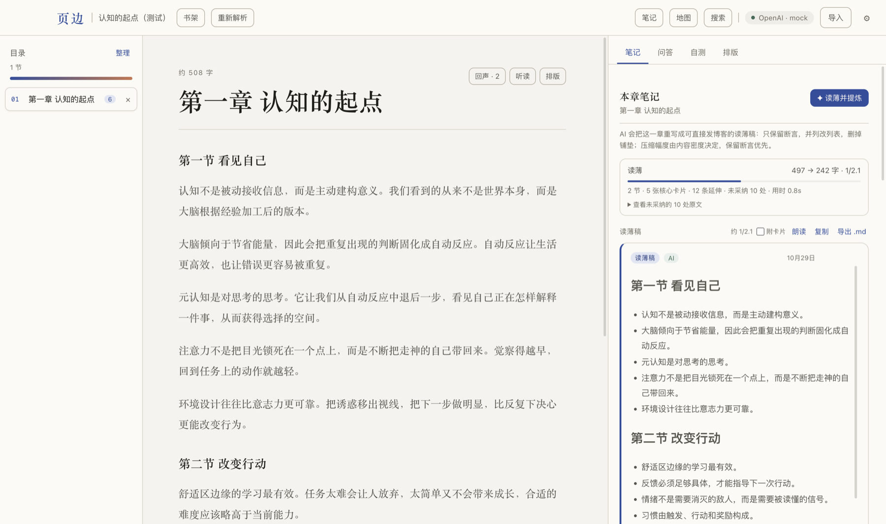
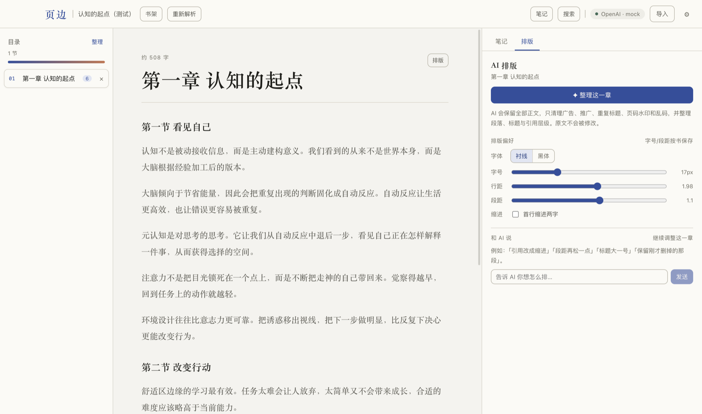
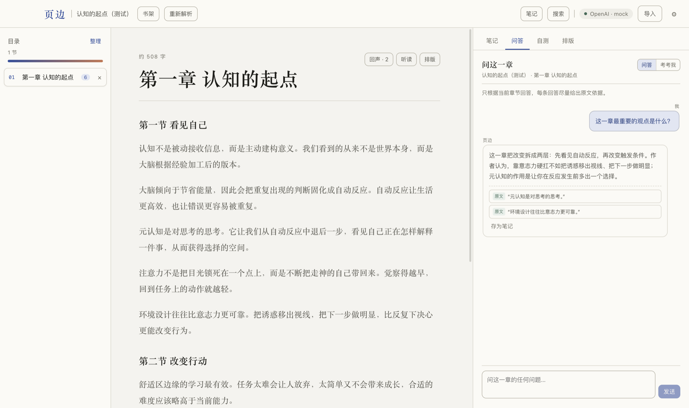
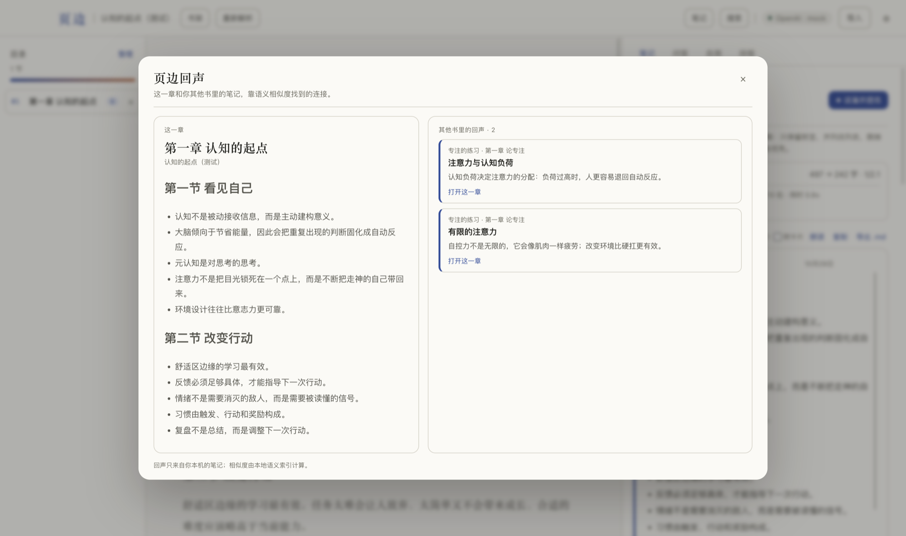
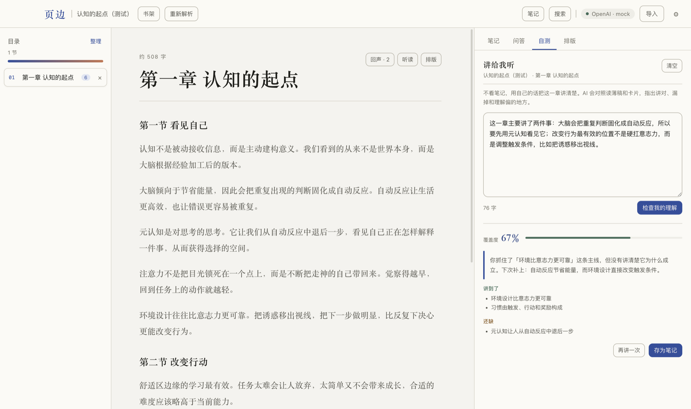
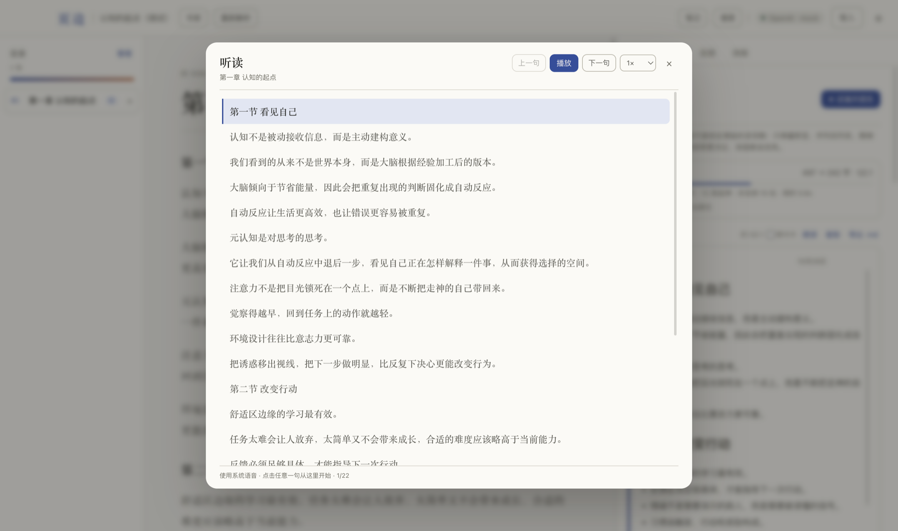
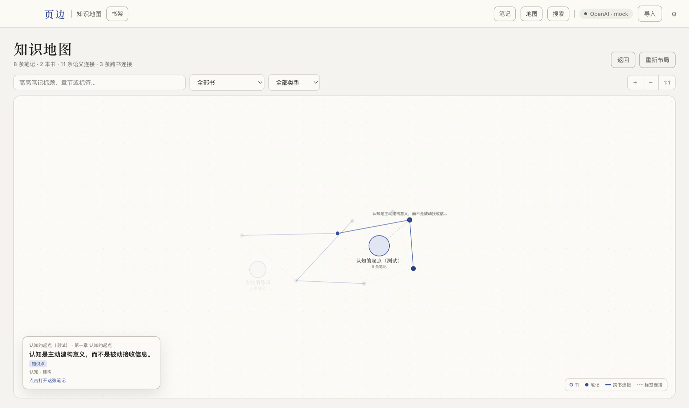
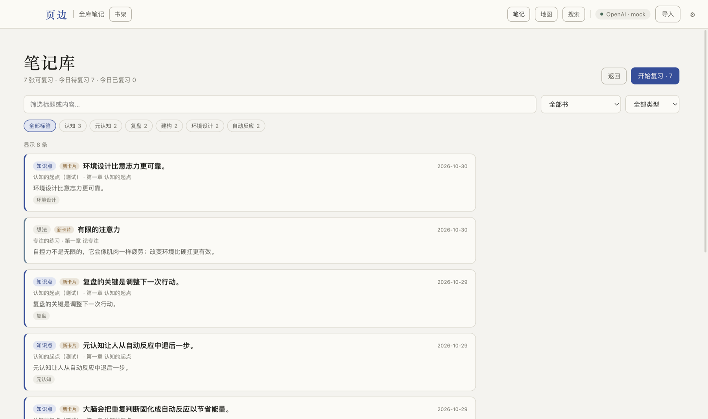
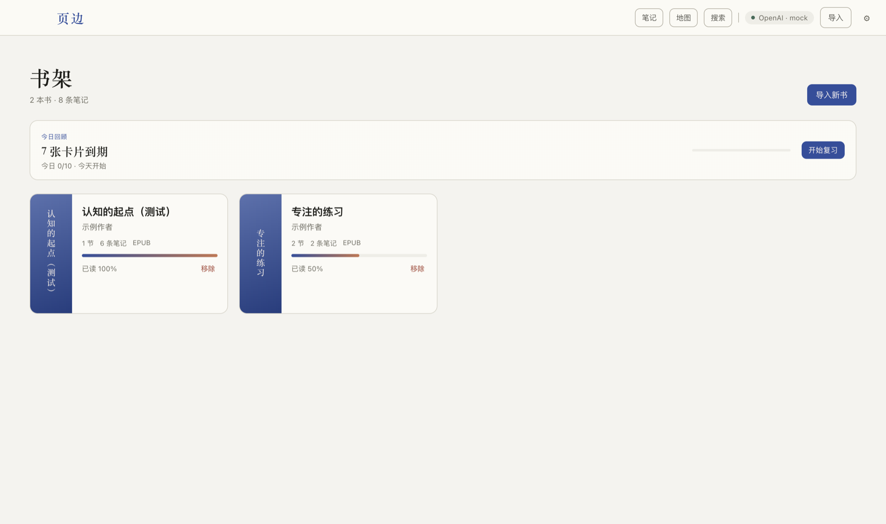
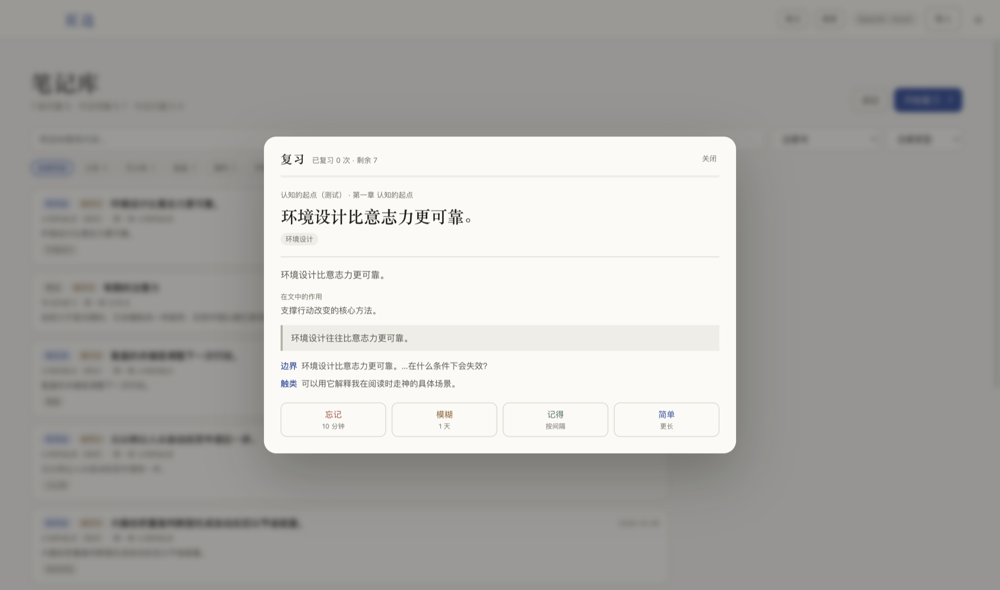

# 页边 · ThinRead

本地优先的 AI 读书笔记桌面应用。导入 EPUB / PDF，AI 先把一章按断言读薄成保留全部观点的读薄稿，再从稿子里提炼少量核心卡片，最后对卡片做有限延伸；你边读边改、直接在章节里问答和复习，笔记之间还可以互相链接。



## 现在能做什么

- **导入** EPUB / PDF。EPUB 保留章节结构、排版和图片；PDF 提取文字层并按页阅读。
- **章节切分**：同一个 XHTML 里的「上篇 / 第一章 / 第二章」会按标题拆开，侧边目录能看到每一章；章节标题不会在正文里重复出现。
- **分篇目录**：上篇/下篇作为可折叠的分组，章归在篇下；篇首页如果有导语内容，会显示成「篇首页」可以单独阅读，否则只保留分组标题。
- **排版整理**：把常见的 `div` 段落、带标题样式的段落、列表、定义列表规范化后再渲染，标题、分段和有序/无序列表都能正常显示。
- **博客级阅读排版**：正文套用 folio 博客的 Markdown 排版风格——宋体正文与标题、1.98 行高、墨蓝强调色，引用块、行内代码、代码块、表格和图片都有完整样式。阅读器默认使用「墨蓝」主题，也可以切换纸色、纯白或暖色；主题会应用到整个应用，而不只是正文。
- **重新解析**：旧书可以用新的解析器重排目录，已有笔记会先按原文引用、再按章节标题重新归属，尽量保留。
- **AI 排版**：右侧「排版」页可以一键让 AI 清理广告、推广、重复标题、页码水印和乱码，并整理标题、段落、引用和列表层级；每一处删除都会列出原因和原文片段，可逐条保留，也可一键还原原文。
- **排版偏好**：字体、字号、行距、段距、首行缩进按书保存；主题在右上角设置里切换，会应用到整个应用（顶栏、侧栏、书架、笔记和正文），默认是参考 folio 的「墨蓝」。
- **导入时自动清理**：本地规则识别封面、版权页、目录、广告、索引、乱码页并自动隐藏；规则会保守判断，隐藏可随时恢复。

正文本身是语义 HTML，阅读器直接套用 folio 的 Markdown 排版规则（标题层级、段落节奏、引用、列表、代码、表格），不会为了 Markdown 再转换一层而丢失结构。
- **整理目录**：AI 或本地规则逐章判断是否属于正文，结果以建议形式列出，勾选后统一隐藏、恢复或删除。删除一章会连同它的笔记一起删除。
- **边读边记**：选中正文直接记笔记，笔记里的原文引用可以点回出处。
- **读薄 + 核心卡片**：按断言重写成可直接发博客的读薄稿，并列项变列表、不插来源标记；压缩幅度由 AI 决定，再从读薄稿按压缩后字数提炼 5–25 张卡片；每张卡写清作用与原文依据，延伸最多 3 条，避免一章变成上百张卡片。
- **问这一章**：右侧「问答」页签，只根据当前章节和读薄稿回答，引用可以点回原文；「考考我」模式会先反问，再顺着你的回答追问。
- **页边回声**：阅读时显示其他书里语义相近的笔记，打开后是左右对读视图，不用离开当前章节就能看到别的书在说什么。
- **讲给我听**：费曼自测，用自己的话解释这一章，AI 对照读薄稿和卡片指出讲对、漏掉和理解偏的地方，可存为笔记。
- **挖空复习 + 今日回顾**：从笔记标签自动挖空关键术语，先填空再翻答案；首页显示今日到期、今日进度和连续复习天数。
- **听读**：用系统语音朗读当前章节或读薄稿，逐句高亮、可调速，点击任意一句从那里开始。
- **知识地图**：顶栏「地图」把全部笔记按书聚成一张图，语义相近的笔记自动连线；可以按书/类型筛选、搜索高亮、缩放拖动，点节点直接回到原文。
- **导出读薄稿**：读薄稿标题栏可以一键复制或导出 Markdown，可勾选是否附上核心卡片；导出内容带书名、作者和日期，正文不夹带「未采纳」等生成说明。
- **全局搜索**：顶栏「搜索」或 `⌘K` / `Ctrl+K` 跨所有书搜索书名、章节正文和笔记；结果按书 / 章节 / 笔记分组，点一下跳到对应章节，笔记结果会自动定位到卡片。
- **全库笔记库**：顶栏「笔记」查看所有书的笔记，按书、类型和标签筛选，点一条回到对应章节和卡片。
- **复习模式**：从笔记库里按到期顺序复习，评分分为忘记 / 模糊 / 记得 / 简单，复习间隔会自动排期；读薄稿和划线不进入复习队列。
- **引用校验**：AI 给出的原文必须能在本章找到；对不上的会标记「未核对」，不假装可信。
- **人机共编**：AI 笔记可以就地修改、补充、删除。改过的笔记标记「AI · 已改」，重新生成不会覆盖你的人工编辑。
- **笔记互链**：用 `[[笔记标题]]` 互相引用，自动显示反向链接、同书相关笔记和跨书相关笔记；跨书关联优先使用本地语义向量（BGE-small-zh），找不到模型时回退到标签/关键词匹配。
- **演示模式**：不配置 API Key 也能跑完整流程，先看交互再接真实模型。
- **本地优先**：书、笔记、生成记录都在本机；只有发给模型的内容会离开设备。

## 跑起来

要求 Node >= 22，pnpm 10+。

```bash
pnpm install
pnpm dev
```

如果 Electron 二进制下载很慢，先设置镜像再安装：

```bash
ELECTRON_MIRROR=https://npmmirror.com/mirrors/electron/ pnpm install
```

pnpm 10+ 默认拦截依赖的构建脚本；项目里的 `pnpm-workspace.yaml` 已经放行 `electron` 和 `esbuild`。

生产构建：

```bash
pnpm build
pnpm start
```

首次启动是空书架。点「导入」选一本 EPUB / PDF；保持右上角的「演示模式」，打开书后点「✦ 生成笔记」就能看到完整流程。

没有现成的书？导入 `samples/sample.epub`（两章的示例书）即可。

## 接模型

右上角设置 → 选服务商 → 填 Base URL、模型、API Key → 「测试连接」。

预置了 DeepSeek、智谱 GLM、Anthropic、OpenAI、Moonshot、阿里云百炼、OpenRouter 和本地 Ollama，也可以填入任意 OpenAI 兼容端点。API Key 用系统钥匙串加密保存在本机；没有钥匙串时回退为 0600 权限的本地文件。

## AI 排版



阅读页点「排版」进入右侧排版面板：

- **整理这一章**：AI 保留全部正文，只清理广告、公众号/书单推广、重复标题、页码水印、乱码和空图片占位，并整理标题、段落、引用和列表的语义层级。
- **移除清单**：每一处删除都显示原因和原文片段，片段必须能在原文里找到；对不上的标记「未核对」。点「保留」会让 AI 带着这条指令重新生成。
- **原文不动**：清理结果单独存在 `formatted_html` 里，原始 HTML 永远保留；「还原原文」随时退回。
- **内容校验**：清理后的文字会和「原文 - 已移除片段」比对；如果 AI 改写、缩写或漏掉太多正文，这次结果会被拒绝，原样保留。
- **排版偏好**：字体、字号、行距、段距、缩进是结构化配置，按书保存，通过 CSS 变量应用，不会让 AI 生成任意 CSS。主题不在这里，去右上角「设置 → 主题」切换，全局生效。
- **对齐与图注**：AI 返回的 `text-align`、`align` 会在清洗时转成安全的 `center` / `right` class，不会被丢掉；图片和图注用 `figure/figcaption` 或 `class="caption"` 渲染并居中。
- **对话调整**：输入「段距大一点」「引用改成缩进」「标题大一号」等指令，AI 会更新内容结构或样式配置，并解释这次改了什么。

演示模式不支持 AI 排版（没有真实模型），但字号、行距、主题等滑杆仍然可用。超长章节（超过约 6 万字符）第一版会直接提示，不会悄悄截断。PDF 章节也可以排版：第一次整理会把文字层转成语义 HTML 后再处理。

## 读书笔记


点「✦ 读薄并提炼」后，严格按三个阶段执行，阶段顺序不跳步：

**阶段一：读薄（AI 决定压缩幅度）**

- 标出每一处「作者在主张什么」，区分断言（必留）、论证材料（留最有力的 1–2 个）和铺垫（删除）。
- 按断言结构重写，把分散的同一论点合并，不照原文段落顺序复制，也不能只做删句。
- 目标是**可以直接发博客**：小标题 + 短段落；并列项改成列表；定义写成「术语：一句话」；例子压成半句。不要写「作者认为」「本章」「接下来」这类元话，也不要在正文里插 `（源：§n）` 或段落编号。
- 每一句话都必须有信息量：删掉它读者仍然能理解作者，就删掉它。删除的铺垫和次要材料进入「未采纳内容」，给出片段和原因。
- 压缩幅度由 AI 根据内容密度决定：论证密集约 1/3，例子多约 1/5，重复多约 1/10；目标是不超过原文一半，能更短就继续删。比例只是参考，保留断言优先。如果模型输出仍明显偏厚，会自动要求它按 1/3 再压一次。
- 读薄稿再和原文做一次断言回查，缺失的观点追加到「补遗（断言回查）」；回查结果不会写回正文，保持正文可发布。

**阶段二：卡片（只从读薄稿提炼）**

- 用一句话测试：不知道它，会影响对全文的理解吗？会，才收；有意思但不影响理解，留在读薄稿里。
- 卡片数量按读薄稿字数决定，不按原文：1000 字以内 5–8 张，1000–3000 字 8–15 张，3000 字以上 15–25 张；超出上限会再筛一次。
- 每张卡必须写清：知识点、它在全文中的作用、原文依据（引用或位置）；案例细节不单独做成卡片。

**阶段三：有限延伸（只在卡片上）**

- 每张卡最多 3 条，类型只有三种：
  - **边界**：这个结论在什么条件下会失效；
  - **跨书**：和已读过的哪本书、哪个观点构成呼应或矛盾，必须写出书名或笔记标题，只使用你其他书里的相关笔记；
  - **触类**：这个机制能解释你生活或工作中的什么具体现象，必须落到具体场景。
- 延伸内容和作者原话分开标注，不会混进知识点。

面板顶部显示「原文 X 字 → 读薄稿 Y 字（1/N） · 节数 · 卡片数 · 延伸数 · 审计补遗 · 未采纳 · 用时」；未采纳的原文片段收在报告下方，点开可逐条查看，不进入读薄稿正文。读薄稿可以阅读、编辑，也可以重新生成；跨书相关笔记在面板底部，点一下直接跳到那本书的那一章。

**速度**：各小节的读薄并发执行（默认 3 路），断言回查和卡片提炼也并行；章节分节越多，节省越明显。面板会显示本次实际用时，方便对比模型和章节。

## 在阅读现场

### 问这一章



右侧「问答」页签把阅读变成对话：AI 只根据当前章节、读薄稿和卡片回答，每条回答尽量给出 1–3 条原文依据；点击引用会滚回正文。回答可以一键存成笔记。切到「考考我」后，AI 不直接给结论，而是先确认你的理解，再追问边界、反例或冲突。

### 页边回声



章节顶部会显示「回声 · N」。点开是左右对读：左边是这一章的读薄稿或卡片，右边是其他书里语义相近的笔记。回声来自你本机的笔记和本地语义索引，不会把书发到外部服务。

### 讲给我听



点「自测」页签，用自己的话讲这一章。AI 对照读薄稿和核心卡片，给出覆盖度、讲到的点、漏掉的点和理解偏差；可以再讲一次，也可以把这次解释和反馈一起存成笔记。

### 听读



阅读器顶部和读薄稿工具栏都有「听读 / 朗读」。面板会逐句高亮当前朗读位置，支持播放、暂停、上一句/下一句和 0.8–1.5 倍速；点击任意一句可以从那里开始。使用系统语音，不需要额外的语音模型。

### 知识地图



顶栏点「地图」进入全库知识地图：书是大的节点，笔记是小的节点，同一本书的笔记先围绕书聚在一起，语义相近的笔记再跨书连线。可以按书和类型筛选、搜索关键词高亮，滚轮缩放、拖动平移；点笔记直接回到那一章，点书打开整本书。没有语义向量时先用标签连接，索引完成后自动刷新。

## 搜索与导出

- **搜索**：顶栏「搜索」或 `⌘K` / `Ctrl+K`，支持书名、作者、章节标题、章节正文和笔记内容；结果可以直接跳到书、章节或具体笔记。
- **复制读薄稿**：读薄稿标题栏的「复制」会把当前编辑后的读薄稿写入剪贴板。
- **导出 Markdown**：「导出 .md」选择保存位置，默认文件名是「书名 章节名.md」；勾选「附卡片」会在文末追加核心卡片、在文中的作用、原文依据和延伸。
- **未采纳内容**：只放在笔记面板的报告折叠区，不会混进导出的正文。

## 笔记库与复习





首页的「今日回顾」会显示今天到期的卡片、今日进度和连续复习天数，点「开始复习」直接进入队列。顶栏点「笔记」进入全库笔记库：可以按书、笔记类型和标签筛选，顶部会显示可复习数量、今日待复习和今日已复习；点任意一条会回到对应书、章节并定位到那张卡片。

**复习**：点「开始复习」按到期顺序进入复习队列。默认开启「挖空回忆」：笔记标签里的关键术语会变成横线，先输入答案再检查；没有可挖空内容的卡片自动回退到翻卡。显示答案后按 1–4 选择忘记 / 模糊 / 记得 / 简单。忘记的卡片会排到本轮队尾，并在 10 分钟后重新到期。



复习采用简化的间隔重复：新卡片第一次评「记得」排 1 天后，之后按难度系数放大间隔；「忘记」会降低难度系数并重新排期。数据只存在本机。

## 数据在哪

macOS：`~/Library/Application Support/reading-notes/`

- `reading-notes.db` — SQLite：书、章节、笔记、笔记的语义向量、复习排期
- `books/<id>/source.epub|pdf` — 导入的原始文件
- `settings.json` — 模型配置和加密后的 Key
- `models/` — BGE-small-zh 量化模型缓存（首次建立跨书语义索引时下载，约 23MB）

## 项目结构

```text
electron/
  main.ts             主进程入口、窗口、开发验证模式
  ipc.ts              渲染层与主进程的 IPC 契约实现
  db.ts               SQLite 存储：书 / 章节 / 笔记 / 章节标记 / 排版结果
  import.ts           解析、自动清理并写入一本书
  settings.ts         模型配置与 Key 的本地存储
  html.ts             HTML 清洗、文本提取、图片占位与还原
  reader-style.ts     阅读样式配置的归一化与持久化
  ai/provider.ts      AI SDK provider 构造
  ai/notes.ts         读薄、断言回查、核心卡片、有限延伸
  ai/classify.ts      章节识别：本地规则 + AI 分类
  ai/format.ts        AI 排版：结构化输出、移除核对、内容完整性校验
  ai/tutor.ts         章节问答、苏格拉底追问、费曼自测评估
  semantic.ts         本地语义索引：BGE-small-zh 嵌入、增量索引、跨书相关笔记
  knowledge-map.ts    知识地图：书/笔记节点、语义与标签连边
  parsers/epub.ts     EPUB 解析（OPF / spine / 图片内联 / 清洗）
  parsers/pdf.ts      PDF 文字层提取与分页
  preload.ts          contextBridge 暴露的 window.api
shared/types.ts       主进程与渲染层共享的类型和 provider 预置
src/
  App.tsx             应用状态与流程编排
  components/         书架、目录、阅读器、笔记面板、问答、自测、笔记库、复习、回声、听读、知识地图、搜索、排版面板、整理目录、设置
  lib/cloze.ts        从标签生成挖空卡片
  lib/export.ts       读薄稿的 Markdown 组装与文件名
  lib/links.ts        反向链接与相关笔记
  styles.css          纸感主题
```

## 设计取舍

1. **笔记是 block 级的，不是一篇可覆盖的 Markdown。** 每条笔记记录来源、作者（AI/我）、是否被人工编辑、引用的原文。这是「AI 自动生成」和「用户边读边改」能共存的前提。
2. **章节也带来源标记和篇归属。** 每一章记录分类（正文/目录/版权页…）、是否隐藏、由规则还是 AI 判断，以及属于上篇/下篇。篇是目录里的分组，不是章节本身；篇首页有内容时单独成为「篇首页」。
3. **目录页整页保留，不逐条拆开。** 目录页被识别为 nav 后自动隐藏；只有真正的章级标题才切分，避免把目录条目和小节混进章节列表。
4. **先读薄，再提炼卡片，最后才延伸。** 按断言重写并自动决定压缩幅度，卡片只从读薄稿里按压缩后字数提炼；不再用逐句提取制造卡片墙，也不在原文上发散。
5. **引用必须可校验。** 生成结果的每条引用都要在本章正文里做规范化匹配；匹配不上就标记未核对。读书笔记最怕的不是总结得平庸，而是编造原文。
6. **笔记链接分三层。** 显式 `[[标题]]`、自动反向链接、本地语义向量带来的同书/跨书相关笔记。图谱视图以后再做，先把「写笔记时能看到相关旧笔记」做好。
7. **AI 排版只动显示层。** 清理结果单独存进 `formatted_html`，原文永远保留；样式偏好是结构化配置，不让模型生成任意 CSS。删除的每一段都要能在原文里核对，改动过大会被拒绝。
8. **本地优先。** 解析、存储、检索都在本机；笔记内容不会离开设备，外部请求只有模型调用和首次下载语义模型。
9. **读薄稿和生成说明分开。** 未采纳内容、审计补遗属于生成报告，不进入导出的正文；导出的 Markdown 只保留能直接发布的内容。
10. **跨书关联用本地向量，不把笔记发出去。** 笔记标题、标签和正文在本机用 BGE-small-zh 计算向量并缓存；模型缺失或首次下载时自动回退到标签匹配，界面不会因此空白。
11. **复习排期是笔记的附属数据，不覆盖笔记本身。** 评分只写 `note_reviews`，删笔记时级联删除；重新生成 AI 笔记会重建卡片，所以旧卡片的复习进度不会迁移到新卡片。
12. **阅读现场的 AI 有边界。** 问答和自测只使用当前章节、读薄稿和卡片；引用会做原文核对，对不上就标记「待核对」，不假装是书中原话。
13. **回声和听读都不改原文。** 回声只读取本地笔记和语义向量；听读只读当前内容，不会生成新文本或改写正文。
14. **知识地图是导航，不是本体论。** 连线来自本地语义相似度和标签，目的是帮你发现相邻的笔记，不代表概念之间存在严格的定义关系；节点多时只展示最近/最重要的笔记，避免变成一团毛线。

模型接入和文档解析参考了 `x-code-cli` 的 provider catalog、`readDocument` 的格式覆盖思路，以及 Electron 的 main / preload / renderer 分层做法。

## 开发验证

```bash
pnpm typecheck                 # 渲染层 + 主进程类型检查
pnpm build                     # esbuild 主进程 + vite 渲染层
node_modules/.bin/electron . --smoke-test
```

`--smoke-test` 会无头跑一遍 EPUB 解析、SQLite 写入和演示生成，输出结构化结果后退出。

界面验证可以用开发模式参数：

```bash
# 用临时数据目录播种一本演示书，打开第一本并截图
node_modules/.bin/electron . --data-dir=/tmp/rn-demo --seed-demo --open-first \
  --screenshot=/tmp/reading-notes.png
```

## 已知限制 / 下一步

- PDF 目前是文字层重排阅读，不保留原始版式；扫描版 PDF 没有 OCR，会明确提示没有文字层。
- 导入时的自动清理使用本地规则，不调用模型；AI 识别在「整理目录」里按需执行，避免导入变慢和产生额外费用。
- 重新解析会重建章节。无法匹配到新章节的笔记会保留下来，但不再显示在章节里；已有的 AI 排版结果会被清空，需要重新整理。
- AI 排版需要真实模型，演示模式只能调整样式滑杆；超过约 6 万字符的超长章节第一版会直接提示不支持。
- AI 仍可能过度删除。移除清单、内容完整性校验和「还原原文」是三道保险；不满意可以逐条保留或整体回退。
- 不同模型的结构化输出差异较大。笔记生成会先尝试流式宽松解析，字段名或类型不一致时会归一化；失败后回退到纯文本 JSON 解析。
- 知识图谱、语音输入尚未实现；目前的听读只做文字转语音。
- 还没有 electron-builder 打包配置，目前用 `pnpm start` 运行；要分发时再加签名与安装包。
- 读薄、卡片和延伸都依赖模型。AI 判断的压缩幅度或卡片数量不合适时，可以换更强的模型重跑；读薄稿会显示审计补遗，未采纳内容也会单独列出。
- 保真审计是 AI 对照原文和读薄稿做的，不是形式化证明。它用来发现明显遗漏，不保证每个隐含意思都被显式写出。
- 跨书语义关联会在首次使用时下载约 23MB 的 BGE-small-zh 量化模型，默认走 `hf-mirror.com`，可以用 `HF_ENDPOINT` 换成其他 Hugging Face 镜像；下载失败时自动回退到标签/关键词匹配。
- 语义索引在 CPU 上运行，笔记很多时首次建索引需要一点时间；之后只增量计算新增或修改过的笔记。
- 全局搜索目前使用 SQLite `LIKE` 扫描，书和笔记很多时可能变慢；下一步可以换 FTS5 或把章节正文分块建索引。
- 复习使用简化版间隔重复，没有撤销和历史曲线；重新生成某章的 AI 笔记会替换卡片，旧卡片的复习排期不会自动迁移。
- 挖空目前只从笔记标签里挑术语；没有可用标签的卡片会自动回退到普通翻卡。
- 问答和自测依赖真实模型；演示模式只返回固定的示例回答。问答记录只保存在当前会话，切换章节会清空。
- 听读使用系统语音，音色和可用性取决于操作系统；没有可用语音时会给出提示。
- 笔记库当前一次最多加载 300 条，筛选在内存里完成；笔记量很大时再做分页和服务端过滤。
- 知识地图一次展示最多 300 条笔记，按重要度和更新时间选取；布局是力导向的，每次重新布局位置会变化，不是固定的概念结构图。
- 知识地图的语义连线需要 BGE 索引；首次建立索引时会先用标签连接，完成后自动刷新。
