# 页边 · ThinRead

[](LICENSE)
[](#安装与构建)
[](https://github.com/qweijiaq/ThinRead/releases)
[](https://github.com/qweijiaq/ThinRead/actions/workflows/ci.yml)

**把一本书读薄成能发布的稿子，而不是再堆一堆划线。**

本地优先的 AI 读书笔记桌面应用。导入 EPUB / PDF / MOBI / 网页或微信读书笔记，把章节读薄成保留全部观点的可发布草稿，提炼 5–25 张核心卡片，再把卡片、笔记和跨书关联整理成一张知识网。Electron + React，数据留在本机，MIT 开源。

> English: ThinRead is a local-first AI reading assistant and book-notes desktop app for knowledge management. It turns each chapter into a publishable draft and a small set of core cards, then connects them across books. EPUB/PDF/MOBI/web/WeChat Reading import, chapter Q&A, Markdown/PDF export. Electron + React, MIT.

📘 [用户手册](docs/user-manual.md) · [PDF 版](docs/user-manual.pdf) · [HTML 版](docs/user-manual.html)

📋 [发布前故障演练记录](docs/release-drill.md)

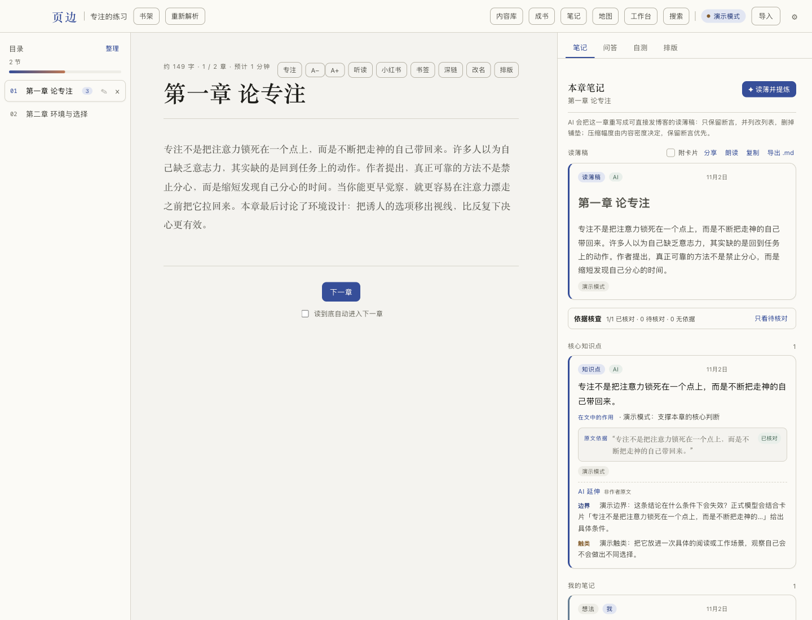

更多界面见 [功能一览](docs/features/README.md)。

**适合谁**：读非虚构、历史、研究资料，想把一本书变成文章、卡片或分享内容的人；已经有一批书和笔记，想找回跨书关联的人；愿意把数据放在本机、自己管理模型 Key 的人。

**不适合谁**：只想要一个纯阅读器、不需要 AI 的人；依赖手机端或多人实时协作的人；完全不希望配置 API Key、也不接受本地模型配置的人。当前只验证 macOS，Windows/Linux 暂不发布安装包。

## 三个核心能力

- **读薄成稿**：不按页摘要，而是按断言重写整章，保留观点和原文依据；生成的读薄稿可以直接继续润色、导出 Markdown/HTML/PDF。
- **核心卡片**：从读薄稿提炼 5–25 张真正影响理解的知识点，写清作用、原文依据和有限延伸；人工修改后不会被下一次生成覆盖。
- **跨书知识网**：用本地语义向量找其他书里的相近笔记，配合知识地图、人物关系图和章节问答，把“这本书说了什么”变成“它和我读过的书有什么关系”。

## 功能一览

| 书架 | 阅读与笔记 | AI 工作台 |
| --- | --- | --- |
|  |  | 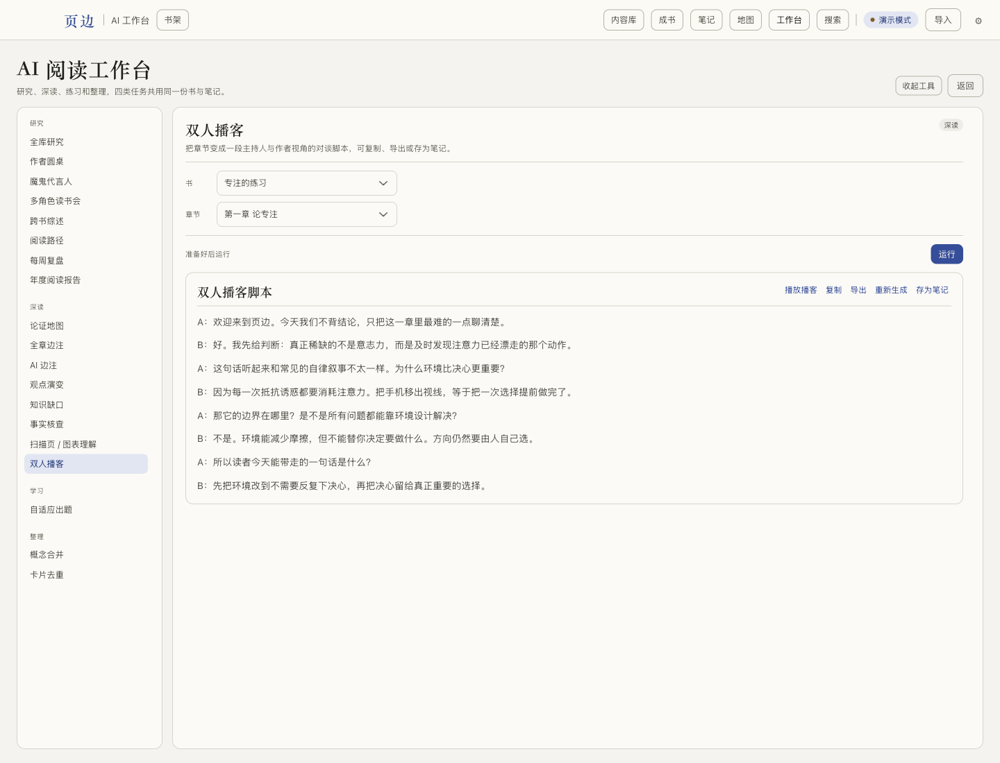 |

| 整本成书 | 分享卡 | 小红书图文 |
| --- | --- | --- |
| 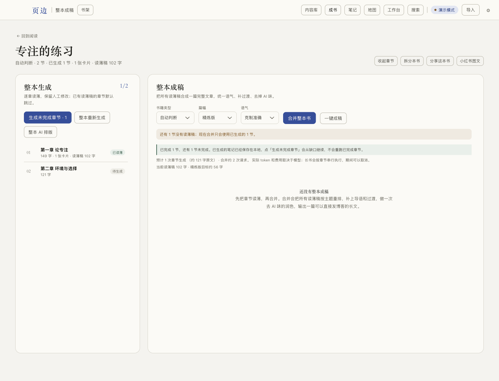 | 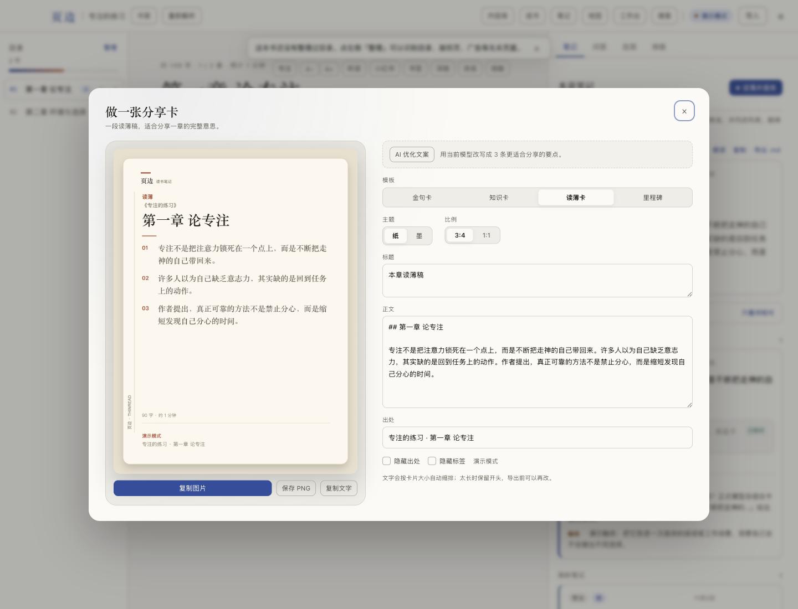 | 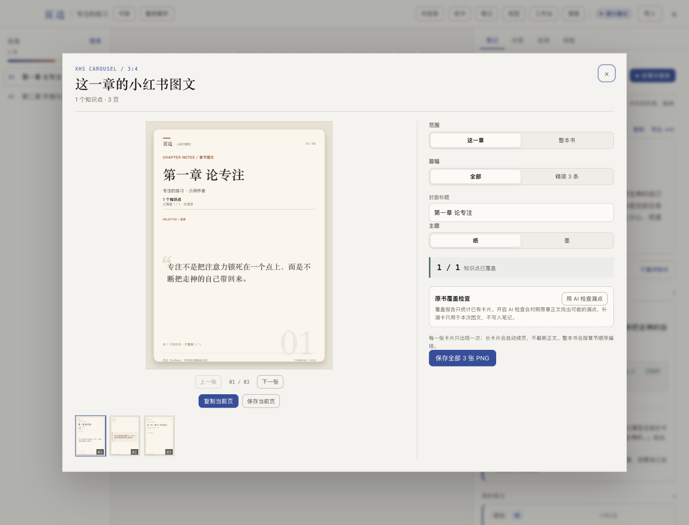 |

阅读统计和更多说明见 [功能一览](docs/features/README.md)。

## 5 分钟试用

要求 Node >= 22、pnpm 10+：

```bash
pnpm install
pnpm dev
```

首次启动是空书架。点「导入」选一本 EPUB/PDF，保持右上角的「演示模式」，打开书后点「✦ 生成笔记」即可看到完整流程，不需要 API Key。

没有书？导入 [samples/sample.epub](samples/sample.epub)（两章示例书）。要接真实模型，见下面的「接模型」。

> macOS 安装包已发布在 [Releases](https://github.com/qweijiaq/ThinRead/releases)；只构建 macOS 未签名版本，不签名、不公证。

## 和同类工具的区别

| | 页边 ThinRead | Readwise Reader | Obsidian | NotebookLM |
|---|---|---|---|---|
| 核心定位 | 把书读成可发布稿、卡片和跨书关联 | 收集、阅读和回顾划线 | 通用双向链接知识库 | 基于资料集的问答、摘要和音频概览 |
| 一本书的产出 | 读薄稿、核心卡片、问答、分享卡/PDF | 高亮、笔记和回顾 | 笔记、链接和插件扩展 | 回答、摘要、音频 |
| 跨书能力 | 本地语义回声 + 知识地图 + 关系图 | 以标签和回顾为主 | 手动双链或插件 | 主要围绕当前资料集 |
| 数据位置 | 本地 SQLite + 文件 | 云端服务 | 本地文件 | 云端服务 |
| 适合的读法 | 深度读非虚构并继续写作 | 高频收集和回顾 | 自己维护知识体系 | 快速理解一组资料 |

这不是功能穷举，而是定位差异：ThinRead 不替代阅读器，也不试图做完整知识库；它专注于“读完这一章之后，能留下什么可复用的东西”。

## 功能

### 导入与阅读

- **多种导入方式**：电子书文件（EPUB / PDF / MOBI / AZW3）、扫描版 PDF（macOS Vision OCR）、文档（DOCX / HTML / Markdown / TXT）、Readwise CSV、Kindle My Clippings、粘贴文本或网页链接。EPUB 保留章节结构、排版和图片；PDF 提取文字层并按页阅读；扫描版逐页 OCR；MOBI 读取目录和章节；DOCX/HTML/Markdown 保留标题层级并自动切章；划线文件按书建立独立书籍并把每条划线保存为高亮笔记；网页会去掉导航和广告后抽取正文。
- **章节切分**：同一个 XHTML 里的「上篇 / 第一章 / 第二章」会按标题拆开，侧边目录能看到每一章；章节标题不会在正文里重复出现。
- **分篇目录**：上篇/下篇作为可折叠的分组，章归在篇下；篇首页如果有导语内容，会显示成「篇首页」可以单独阅读，否则只保留分组标题。
- **排版整理**：把常见的 `div` 段落、带标题样式的段落、列表、定义列表规范化后再渲染，标题、分段和有序/无序列表都能正常显示。
- **博客级阅读排版**：正文套用 folio 博客的 Markdown 排版风格——宋体正文与标题、1.98 行高、墨蓝强调色，引用块、行内代码、代码块、表格和图片都有完整样式。阅读器默认使用「墨蓝」主题，也可以切换纸色、纯白或暖色；主题会应用到整个应用，而不只是正文。
- **重新解析**：旧书可以用新的解析器重排目录，已有笔记会先按原文引用、再按章节标题重新归属，尽量保留。
- **AI 排版**：右侧「排版」页可以一键让 AI 清理广告、推广、重复标题、页码水印和乱码，并整理标题、段落、引用和列表层级；每一处删除都会列出原因和原文片段，可逐条保留，也可一键还原原文。
- **排版偏好**：字体、字号、行距、段距、首行缩进和版心宽度按书保存；主题在右上角设置里切换，会应用到整个应用（顶栏、侧栏、书架、笔记和正文），默认是参考 folio 的「墨蓝」。
- **导入时自动清理**：本地规则识别封面、版权页、目录、广告、索引、乱码页并自动隐藏；规则会保守判断，隐藏可随时恢复。

正文本身是语义 HTML，阅读器直接套用 folio 的 Markdown 排版规则（标题层级、段落节奏、引用、列表、代码、表格），不会为了 Markdown 再转换一层而丢失结构。
- **整理目录**：AI 或本地规则逐章判断是否属于正文，结果以建议形式列出，勾选后统一隐藏、恢复或删除。删除一章会连同它的笔记一起删除。EPUB 导入会提取封面并在书架显示。
- **边读边记**：选中正文会浮出操作条——高亮、划线、删除（删除线）、清除标记、问 AI、AI 边注、分享、朗读、复制；标记按章节保存在本地，重开书仍在；问 AI 会把原文带进右侧问答，分享会直接生成金句卡草稿。

### 读薄、卡片与问答

- **读薄 + 核心卡片**：按断言重写成可直接发博客的读薄稿，并列项变列表、不插来源标记；压缩幅度由 AI 决定，再从读薄稿按压缩后字数提炼 5–25 张卡片；每张卡写清作用与原文依据，延伸最多 3 条，避免一章变成上百张卡片；原文依据必须能在本章逐字找到，找不到就留空，不会把模型改写过的句子伪装成原文。知识点卡片直接用完整正文作为主句，不再显示被截断、和正文重复的自动标题；只有标题确实不同时才保留标题。
- **问这一章**：右侧「问答」页签，只根据当前章节和读薄稿回答，引用可以点回原文；回答会边生成边显示；「考考我」模式会先反问，再顺着你的回答追问。
- **页边回声**：阅读时显示其他书里语义相近的笔记，打开后是左右对读视图，不用离开当前章节就能看到别的书在说什么。
- **讲给我听**：费曼自测，用自己的话解释这一章，AI 对照读薄稿和卡片指出讲对、漏掉和理解偏的地方，反馈和聊天回答一样边生成边显示，可存为笔记。
- **阅读小结**：阅读器顶部「小结」按本次阅读时长、当前章节和已有笔记生成「本次读到 / 还存着的疑问 / 下一步」，可重新生成、复制或存为当前章节笔记；演示模式会返回固定样例。
- **模型对比**：笔记面板的「模型对比」可以用另一个推荐模型重跑本章，结果存入内容库并直接打开行级 diff；不会覆盖当前笔记。

### 知识地图与 AI 工作台

- **听读**：用千问 TTS 朗读当前章节或读薄稿，逐句高亮、可调速，点击任意一句从那里开始。
- **知识地图**：顶栏「地图」把书和标签概念组织成一张概念图；概念按共现连边，跨书概念会单独标出。没有标签的笔记会汇总到「未归类」节点，不会在地图里消失；可以按书筛选、搜索、只看跨书概念，单击节点查看概念下的笔记；拖动节点后的位置会保存在本地，搜索框回车直接定位到第一个匹配项，也可以把整张图复制成 Mermaid 或导出为 PNG。
- **整本成书**：顶栏或书架卡片点「成书」，可以一次给整本书未完成的章节生成读薄稿；再把所有读薄稿合并、润色成一篇去 AI 味的长文，导出 Markdown、自包含 HTML 分享页、排版 PDF 或完整发布包。分享页带封面、目录锚点、SEO/OG 元信息和阅读时长。
- **生成档位**：设置里可选快速 / 标准 / 精读。快速档跳过断言回查和卡片延伸，标准档保留完整流程，精读档额外做一轮细节回查，并复用同一段 24k 原文前缀（Anthropic 显式 `cache_control`，OpenAI-compatible 端点走自动前缀缓存）；断言回查已经合并进卡片提炼，只上传一次原文；短章或压缩率低时自动省略回查，卡片少于 4 张时省略延伸；同一章、同一模型、同一档位的结果按内容哈希缓存 14 天，命中时 0 token，可点「强制重新生成」跳过缓存；读薄报告会显示本次档位、用时和 token 用量。设置里还可以为读薄、成稿和工作台分别指定模型，留空使用全局模型。
- **书籍类型**：成书页可把书标成非虚构、历史、历史小说、小说、侦探、传记或神话。类型只作为提示，让读薄、成稿和人物关系图保留该类书真正重要的内容，不限制功能。
- **后台任务**：整本生成和整本 AI 排版进行时，右下角任务中心会持续显示进度；任务写入本地数据库，应用重启后会变成「已暂停」，可以跳过已完成章节继续，也可以暂停或取消。新任务取消上一个 AI 任务时会弹出提示。
- **生成内容库**：顶栏「内容库」集中查看所有 AI 结果，支持搜索、收藏、归档、删除、存为笔记、应用排版，以及把旧题目 / 对话设为当前；同一工具、同一范围的历史版本可以做文本 diff，查看这一版改了什么；回收站里的内容可以彻底删除或一键清空，二次确认后从本机数据库移除；生成内容也会进入全局搜索。
- **分享卡**：笔记卡片、读薄稿、笔记库和阅读里程碑都能直接分享；金句卡 / 知识卡 / 读薄卡 / 整本书 / 长图 / 里程碑六种版式，纸、墨、苔绿三套主题；参考 daily-post 的深色编辑排版：炭黑或网格纸背景、等宽字索引、荧光黄/红章强调色、粗规则线和更大的无衬线标题，正文会自动去掉 Markdown 标记、避免标点出现在行首，并按中文词边界换行；每段会本地提取一处关键短语做荧光笔标注，浅色主题铺底、深色主题下划线；读薄卡还会从正文里提炼 3–4 条要点；预览区做成独立衬纸，支持复制图片、保存 PNG 和复制文字。也可以点「AI 优化文案」，用当前模型改写成标题 + 3 条更适合分享的要点（演示模式或未配置模型时用本地提炼）。
- **分享署名**：分享卡和小红书弹窗都可以填「署名 / 品牌（可选）」，会画在卡片右下角或替换小红书页脚，保存在本机。
- **小红书图文**：阅读器章节头部和成书页都可以打开同一个弹窗，在「这一章 / 整本书」之间切换；章节范围还能直接选择其他章节，生成一组 3:4 帖子图。自动加封面和结尾，把核心知识点分页排完；封面用大号标题、强调线和「选读」区块做视觉主体，内容页是无底色的编辑排版，带大号页码水印、底部进度线和关键短语高亮，结尾页会列出本章知识点或全书章节回顾；正文按手机可读性整体放大，默认使用深色「墨」主题；每个知识点只出现一次，长卡片自动续页；可以切换「精简 3 条」只保留前三个知识点，适合短图文。支持预览、单页保存和整套保存。弹窗里还可以用当前模型检查「原章正文 → 卡片」的疑似漏点，把补漏临时加入图文。
- **阅读位置与书签**：滚动位置按章节保存在本地，重新打开回到上次位置；PDF 原版查看器也会记住上次页码；阅读器可以存书签，同一位置不会重复创建，侧栏可以直接跳回或删除书签。
- **章末自动续读**：设置 →「自动续读」或章末勾选后，滚到章尾会出现 3 秒倒计时，可随时取消；默认关闭，偏好记在本机。
- **阅读计划**：书架卡片「计划」按每天阅读分钟数把可见章节连续排到各天（默认取每日目标，未设置时按 30 分钟），纯本地计算、不调用模型；勾选章节即记录已读进度，计划保存在本机数据库并随备份迁移；点章节标题可以直接打开该章。书架顶部会显示「今日阅读计划」，可以直接从今天的第一节继续。
- **阅读时长与目标**：阅读器每 15 秒累计一次本地阅读时间（连续 2 分钟无操作时暂停计时），书架顶部显示今日/本周和每日目标的完成进度；「阅读统计」页面可以查看今日、本周、月度（可切换月份）、年度（按 12 个月）、累计、每日柱状图和按书耗时，达成每日目标时会提示一次，并显示当前连续阅读天数与距离下一个里程碑（7/30/100 天）的进度；统计页有一面 7/30/100 天的里程碑徽章墙，可以导出徽章分享图；本周复盘可以一键跳到工作台调用模型生成报告，也可以直接存成本地周复盘（只保存阅读统计，独立于书籍，按 ISO 周归档，同一周重复保存会更新同一条），还能把当月每日数据复制成 CSV，或导出月/年统计图片，并对比今年和上一年的阅读量（含 12 个月对比柱状图）。「查看历次周复盘」会按周列出所有周复盘，支持按年份筛选，点开直接看正文；徽章分享图支持纸/墨两种主题；统计图片支持月/年/对比三种导出。设置里可以填每日目标（0 表示不设）。统计页底部还会汇总近 30 天 AI 调用次数、失败数和 token，并按模型/任务拆分；数据来自本机 `ai-traces`，不包含提示词或正文。
- **阅读快捷键与专注模式**：←/→ 或 j/k 切换上一章/下一章，f 进入/退出专注阅读（隐藏顶栏、目录和侧栏），b 在当前阅读位置加书签，g / G 跳到章首 / 章尾，`?` 打开快捷键帮助，Esc 关闭选区或退出专注；章节头部显示「第几 / 共几章」和预计阅读时间，A−/A+ 调整字号，顶部细条显示本章阅读进度，章末可以直接进入下一章。
- **整章音频**：听读面板可以把整章/整篇脚本一次合成成 WAV，支持播放和保存，不再只能逐句生成。
- **微信读书导入**：支持导入微信读书复制/导出的 TXT、Markdown 或 HTML 笔记，按书名、作者、章节、划线和想法建立高亮笔记；Readwise 与 Kindle 入口保持不变。
- **AI 工作台**：顶栏「工作台」按研究、深读、学习、整理四组组织 19 个工具，覆盖全库研究、作者圆桌、跨书综述、论证地图、自适应出题、概念合并和卡片去重等；人物关系图移到「地图」页，分享卡回到成书页，行动实验、语音研究等边缘入口已移除。结果会持久化，重启后还能继续查看或重新生成。

### 输出、搜索与本地数据

- **书名/作者可改**：书架卡片或顶栏书名可以同时编辑书名和作者；章节名、分篇名也可以重命名；笔记标题沿用笔记卡片的编辑入口。
- **导出读薄稿**：读薄稿标题栏可以一键复制或导出 Markdown，可勾选是否附上核心卡片；导出内容带书名、作者和日期，正文不夹带「未采纳」等生成说明。
- **全局搜索**：顶栏「搜索」或 `⌘K` / `Ctrl+K` 跨所有书搜索书名、章节正文和笔记；结果按书 / 章节 / 笔记分组，点一下跳到对应章节，笔记结果会自动定位到卡片。搜索框为空时显示快速操作，输入 `>` 可以过滤命令，直接跳到书架、内容库、统计、设置等页面。关键词倒排索引先返回，本地语义检索随后补充；两路结果用 RRF 融合排序。全文索引缓存到数据目录，签名不变时启动直接加载。
- **书目整理**：书架可以把多本书合并成一本；阅读器的「成书」页可以把一本书按章节拆成两本。合并会移动章节和笔记并移除其他源书；拆分后两本书都可独立阅读和重解析。
- **全库笔记库**：顶栏「笔记」查看所有书的笔记，按书、类型和标签筛选，点一条回到对应章节和卡片；也可以多选几条做成一张长图。顶部「笔记审计」会显示 AI/人工修改、已核对/待核对/无引用引用数，以及有笔记和读薄稿的章节覆盖度，并可直接筛出待核对、无引用或人工修改的笔记。可以把当前筛选结果或多选笔记导出为带 YAML frontmatter 的 Markdown 文件夹，直接放进 Obsidian 仓库或导入 Notion。删除的笔记会进入「回收站」，保留 30 天，可以恢复或彻底删除。笔记面板的「依据核查」可以只筛出待核对、无依据的 AI 卡片，点原文依据回到原句。
- **章节回收站**：整理目录时删除的章节、笔记、书签和标记会进入章节回收站，保留 30 天，可恢复或彻底删除，不再直接落盘。
- **引用校验**：AI 给出的原文必须能在本章找到；对不上的会标记「未核对」，不假装可信。
- **人机共编**：AI 笔记可以就地修改、补充、删除。改过的笔记标记「AI · 已改」，重新生成不会覆盖你的人工编辑。编辑时可以先看 Markdown 实时预览，也可以用「插入 Mermaid」直接写流程图、时序图或时间线。
- **笔记互链**：用 `[[笔记标题]]` 互相引用，自动显示反向链接、同书相关笔记和跨书相关笔记；跨书关联优先使用本地语义向量（BGE-small-zh），找不到模型时回退到标签/关键词匹配。
- **演示模式**：不配置 API Key 也能跑完整流程，先看交互再接真实模型。
- **本地优先**：书、笔记、生成记录都在本机；只有发给模型的内容会离开设备。
- **自动备份**：合并、拆分、重新解析或删除书籍前会自动生成完整备份；设置里可以手动备份、查看历史、恢复并重载应用。备份包含数据库、书籍文件和设置。

## 安装与构建

如果 Electron 二进制下载很慢，先设置镜像再安装：

```bash
ELECTRON_MIRROR=https://npmmirror.com/mirrors/electron/ pnpm install
```

pnpm 10+ 默认拦截依赖的构建脚本；项目里的 `pnpm-workspace.yaml` 已经放行 `electron` 和 `esbuild`。

生产构建：

```bash
pnpm build
pnpm start
```

## 深链

阅读器章节头部的「深链」按钮会复制：

```text
thinread://book/<bookId>/chapter/<chapterId>
```

也支持带引文定位的 `?quote=<原文>`。安装过应用后，这个链接可以直接打开对应书和章节；目前只在 macOS 上注册协议。v0.1.1 安装包已包含深链；v0.1.0 及更早版本不包含。

## 导入

点「导入」可以选择三种入口：

- **电子书 / 文档文件**：EPUB、PDF、MOBI、AZW3、DOCX、HTML、Markdown、TXT。MOBI 会读取目录和章节；DOCX/HTML/Markdown 会保留标题层级并切成章节；DRM 加密文件会明确报错。
- **原版 PDF**：PDF 书籍在阅读器里可以打开「原版 PDF」，用 PDF.js 按页查看原始版式、缩放和翻页；文字重排、划词和 AI 笔记仍在普通章节视图里。
- **扫描版 PDF**：在导入弹窗里单独选择「扫描版 PDF（OCR）」。macOS 用 PDFKit 渲染页面、Vision 逐页识别，可指定起始/结束页，单次最多 300 页；选完文件后会转到右下角任务中心，可以离开页面、查看进度或取消。识别结果会优先按 PDF 书签/大纲切成真实章节；没有可用书签时按连续页码切成章节，并自动跳过广告、版权页和过短的封面页。页码会保留在正文里，后续可以正常读薄和排版。
- **划线 / 标注**：导入 Readwise CSV 或 Kindle 的 `My Clippings.txt`；默认每本书建立独立书籍，也可以勾选「合并到同名书」，把划线追加到书名和作者匹配的已有书。每条划线保存为高亮笔记，Readwise 的标签和备注会一起保留；配置 Readwise Token 后也可以在导入弹窗里直接同步官方划线。
- **粘贴文本**：直接填标题、作者和正文，按 `#`、`第X章`、`Chapter N` 等标题自动切章；没有标题时作为一章导入。
- **网页链接**：抓取公开的 http/https 页面，去掉导航、脚本和广告后提取正文；不下载远程图片。

导入本身不需要调用模型，目录识别使用本地规则；之后可以再按需运行「整理目录」或 AI 排版。

## 接模型

右上角设置 → 选服务商 → 填 Base URL、模型、API Key → 「测试连接」。模型输入框会按服务商给出推荐候选，也可以直接粘贴任意模型 ID。

预置了 DeepSeek、智谱 GLM、Anthropic、OpenAI、Moonshot、阿里云百炼、OpenRouter 和本地 Ollama，也可以填入任意 OpenAI 兼容端点。API Key 用系统钥匙串加密保存在本机；没有钥匙串时回退为 0600 权限的本地文件。

## AI 排版

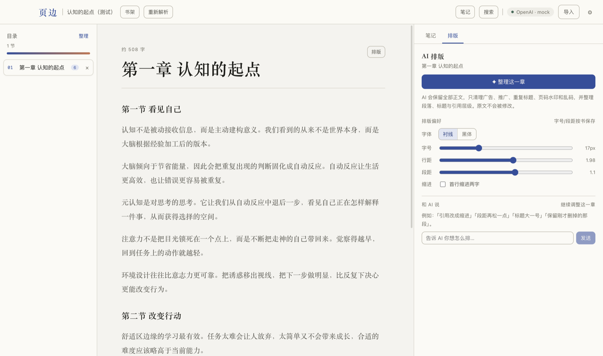

阅读页点「排版」进入右侧排版面板：

- **整理这一章**：AI 保留全部正文，只清理广告、公众号/书单推广、重复标题、页码水印、乱码和空图片占位，并整理标题、段落、引用和列表的语义层级。
- **移除清单**：每一处删除都显示原因和原文片段，片段必须能在原文里找到；对不上的标记「未核对」。点「保留」会让 AI 带着这条指令重新生成。
- **原文不动**：清理结果单独存在 `formatted_html` 里，原始 HTML 永远保留；「还原原文」随时退回。
- **内容校验**：清理后的文字会和「原文 - 已移除片段」比对；如果 AI 改写、缩写或漏掉太多正文，这次结果会被拒绝，原样保留。
- **排版偏好**：字体、字号、行距、段距、缩进是结构化配置，按书保存，通过 CSS 变量应用，不会让 AI 生成任意 CSS。主题不在这里，去右上角「设置 → 主题」切换，全局生效。
- **对齐与图注**：AI 返回的 `text-align`、`align` 会在清洗时转成安全的 `center` / `right` class，不会被丢掉；图片和图注用 `figure/figcaption` 或 `class="caption"` 渲染并居中。
- **对话调整**：输入「段距大一点」「引用改成缩进」「标题大一号」等指令，AI 会更新内容结构或样式配置，并解释这次改了什么。

演示模式不支持 AI 排版（没有真实模型），但字号、行距、主题等滑杆仍然可用。超长章节（超过约 6 万字符）第一版会直接提示，不会悄悄截断。PDF 章节也可以排版：第一次整理会把文字层转成语义 HTML 后再处理。

## 读书笔记

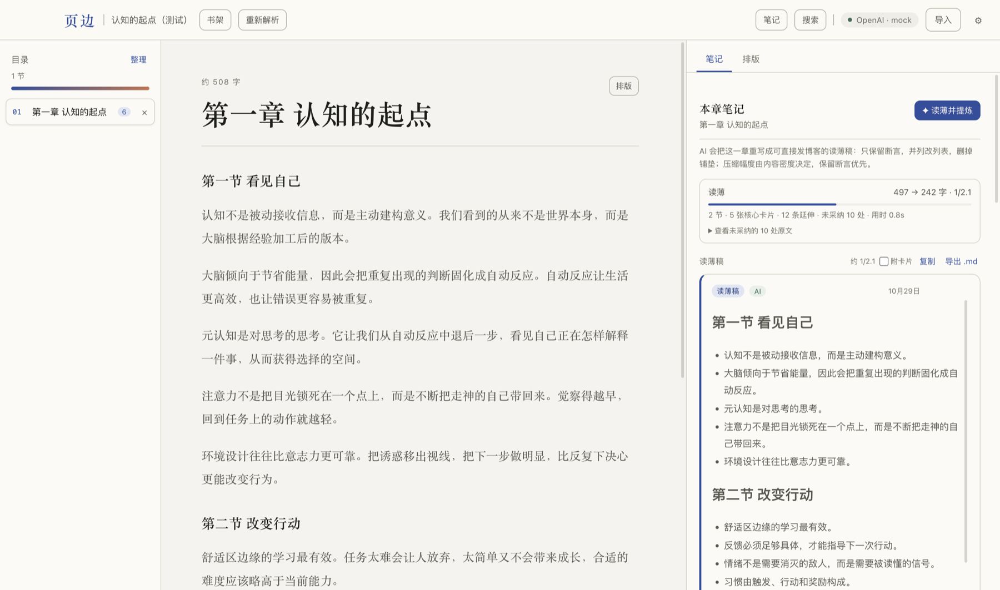

点「✦ 读薄并提炼」后，严格按三个阶段执行，阶段顺序不跳步：

**阶段一：读薄（AI 决定压缩幅度）**

- 标出每一处「作者在主张什么」，区分断言（必留）、论证材料（留最有力的 1–2 个）和铺垫（删除）。
- 按断言结构重写，把分散的同一论点合并，不照原文段落顺序复制，也不能只做删句。
- 目标是**可以直接发博客**：小标题 + 短段落；并列项改成列表；定义写成「术语：一句话」；例子压成半句。不要写「作者认为」「本章」「接下来」这类元话，也不要在正文里插 `（源：§n）` 或段落编号。
- 每一句话都必须有信息量：删掉它读者仍然能理解作者，就删掉它。删除的铺垫和次要材料进入「未采纳内容」，给出片段和原因。
- 压缩幅度由 AI 根据内容密度决定：论证密集约 1/3，例子多约 1/5，重复多约 1/10；目标是不超过原文一半，能更短就继续删。比例只是参考，保留断言优先。如果模型输出仍明显偏厚，会自动要求它按 1/3 再压一次。
- 提炼卡片时顺带做断言回查，不再单独上传一遍原文；缺失的观点追加到「补遗（断言回查）」，回查结果不会写回正文，保持正文可发布。

**阶段二：卡片（只从读薄稿提炼）**

- 用一句话测试：不知道它，会影响对全文的理解吗？会，才收；有意思但不影响理解，留在读薄稿里。
- 卡片数量按读薄稿字数决定，不按原文：1000 字以内 5–8 张，1000–3000 字 8–15 张，3000 字以上 15–25 张；超出上限会再筛一次。
- 每张卡必须写清：知识点、它在全文中的作用、原文依据（引用或位置）；案例细节不单独做成卡片。

**阶段三：有限延伸（只在卡片上）**

- 每张卡最多 3 条，类型只有三种：
  - **边界**：这个结论在什么条件下会失效；
  - **跨书**：和已读过的哪本书、哪个观点构成呼应或矛盾，必须写出书名或笔记标题，只使用你其他书里的相关笔记；
  - **触类**：这个机制能解释你生活或工作中的什么具体现象，必须落到具体场景。
- 延伸内容和作者原话分开标注，不会混进知识点。

面板顶部显示「原文 X 字 → 读薄稿 Y 字（1/N） · 节数 · 卡片数 · 延伸数 · 审计补遗 · 未采纳 · 用时」；未采纳的原文片段收在报告下方，点开可逐条查看，不进入读薄稿正文。读薄稿可以阅读、编辑，也可以重新生成；跨书相关笔记在面板底部，点一下直接跳到那本书的那一章。

**速度**：各小节的读薄并发执行（默认 4 路），断言回查和卡片提炼也并行；章节分节越多，节省越明显。面板会显示本次实际用时和生成档位，方便对比模型和章节；短章、低压缩率和小卡片集会自动跳过收益不高的阶段；精读档的回查会复用读卡片时上传的原文前缀；同一章+模型+档位的重复生成直接读缓存，报告里会标「缓存命中」并显示省下的 token。

## 在阅读现场

### 问这一章

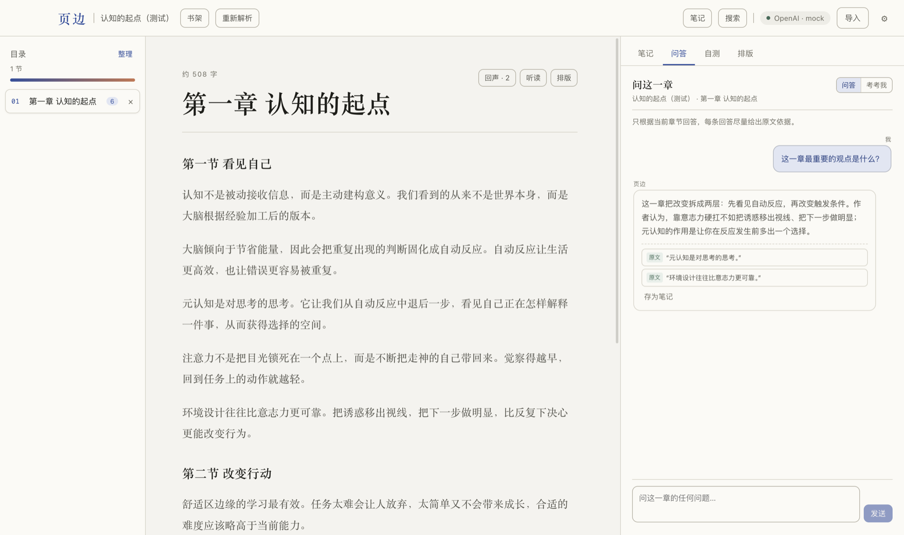

右侧「问答」页签把阅读变成对话：AI 只根据当前章节、读薄稿和卡片回答，每条回答尽量给出 1–3 条原文依据；点击引用会滚回正文。回答可以一键存成笔记。切到「考考我」后，AI 不直接给结论，而是先确认你的理解，再追问边界、反例或冲突。

### 页边回声

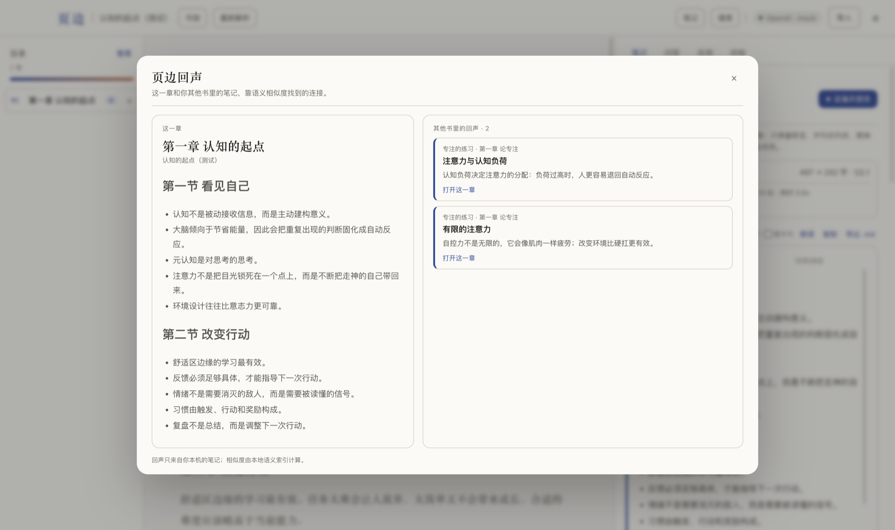

章节顶部会显示「回声 · N」。点开是左右对读：左边是这一章的读薄稿或卡片，右边是其他书里语义相近的笔记。回声来自你本机的笔记和本地语义索引，不会把书发到外部服务。

### 讲给我听

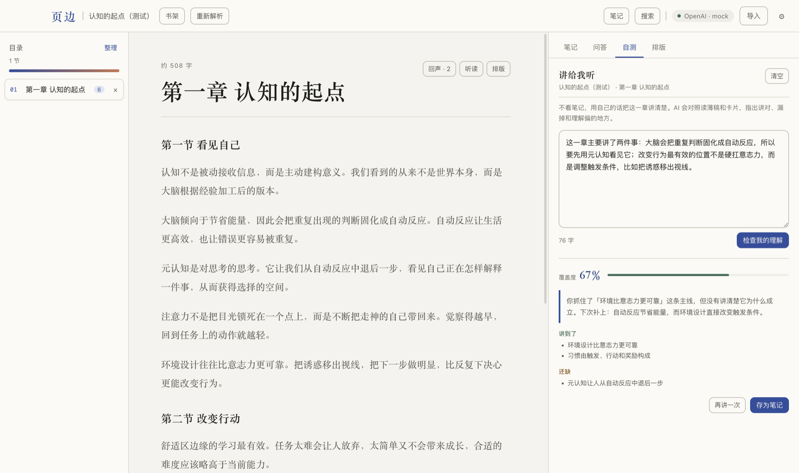

点「自测」页签，用自己的话讲这一章。AI 对照读薄稿和核心卡片，给出覆盖度、讲到的点、漏掉的点和理解偏差；可以再讲一次，也可以把这次解释和反馈一起存成笔记。

### 听读

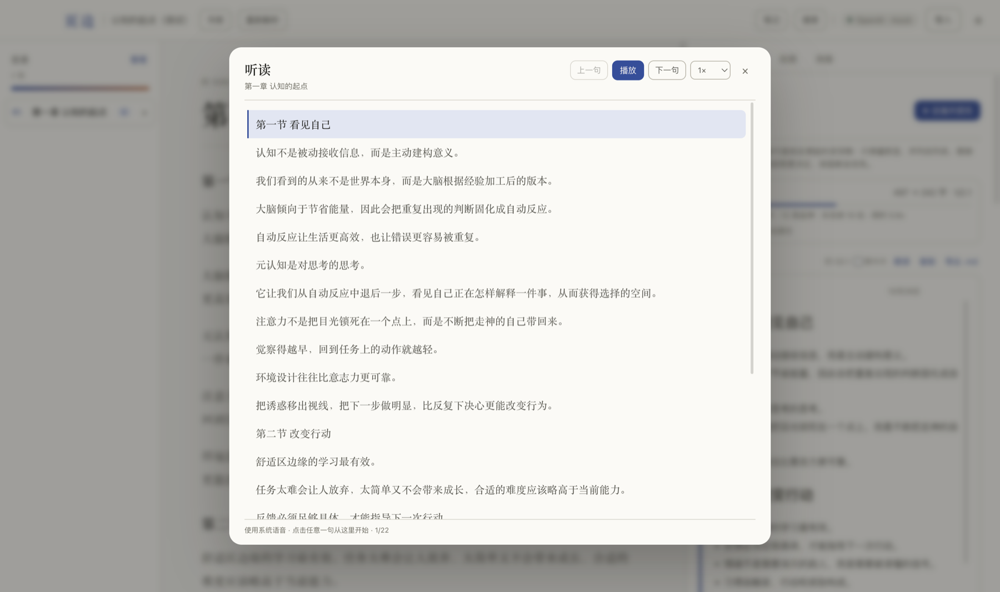

阅读器顶部和读薄稿工具栏都有「听读 / 朗读」。面板会逐句高亮当前朗读位置，支持播放、暂停、上一句/下一句和 0.8–1.5 倍速；点击任意一句可以从那里开始。带 `A：` / `B：` 标记的对白会按角色拆分，角色标签不会进入朗读。

播客脚本按 SkillHub 的 `@beatra-ai/ai-podcast-voiceover` 口播原则整理：短句、口语、数字和术语写成读得出来的形式，不输出旁白或角色说明。当前只保留播客文稿，不提供播客播放入口。

### 语音合成

听读面板使用阿里云百炼的千问语音合成，与 english-penpal 同款：

- 模型 `qwen-audio-3.1-tts-flash`，走百炼原生 `SpeechSynthesizer` 接口（兼容模式没有 `/audio/speech`）。
- 打开设置 →「千问 TTS（阿里云百炼）」，填写 Base URL、模型、A/B 音色和 Key。Key 留空时会复用「阿里云百炼」主模型的 Key；专属业务空间把 Base URL 换成自己的域名。
- 默认 A 音色是龙安欢女声，默认 B 音色是许南川男声；对白里的 A/B 角色会分别请求音色再顺序播放。听读面板里改 A/B 音色会直接保存为默认音色。
- 默认英文音色是 Emily；纯英文段落自动使用它，清空后复用 A 音色。
- 可填写「元/千字符」价格；整章导出前会按字符数估算费用，实际以百炼账单为准。
- 可维护自己的音色库：保存音色 ID，一键设为 A/B/英文；音色库只保存 ID，不会自动验证。
- 支持 15/30/60 分钟睡眠定时；关闭再打开会从上次听读位置继续。
- 听读面板可最小化为左下角迷你播放器，切换到书架、笔记或工作台时继续播放；整章导出可选 0 / 0.5 / 1 秒段落间隔，方便播客剪辑。
- 整章音频可保存为 WAV 或 MP3（单声道 64kbps）。
- 按字符计费，文本会发送到阿里云百炼。当前句播放时会预取下一句；整章音频会逐段合成后合并成一个 WAV。

原有的系统语音、Edge 在线音色、Beatra 付费配音和 OpenAI 兼容 TTS 已全部移除。

### 知识地图

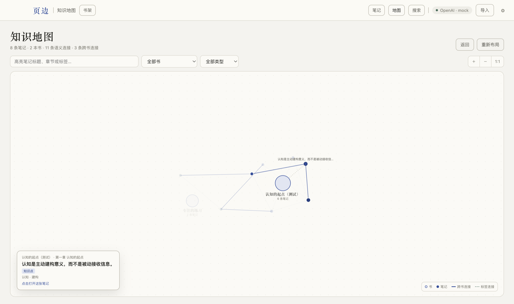

顶栏点「地图」进入地图页，顶部可以在「知识地图」和「人物关系」两个模式之间切换。知识地图不再把所有笔记都铺成一张毛线图，而是以**书和标签概念**为节点：书是大的节点，概念是小的节点；同一本书的多个概念围绕书聚在一起，概念之间按共同出现的笔记连边，被多本书共用的概念会标成「跨书」。

单击概念会在右侧列出它下面的笔记，点笔记直接回到原文；单击书会显示这本书的概念和全部笔记，双击书或点「打开这本书」进入阅读器。可以按书筛选、搜索概念或书名、只看跨书概念，滚轮缩放、拖动平移；拖动节点后的位置会按节点保存在本地，下次打开仍然保持，点「重新布局」才会重新计算。搜索框按回车会直接定位并选中第一个匹配节点，地图工具栏也可以把当前概念图复制成 Mermaid，或按完整节点范围导出成 PNG；导出图保留当前主题的纸色、点阵背景和节点配色。没有标签的笔记会汇总到「未归类」节点，仍然可以在概念图上查看。

切到「人物关系」并选一本书，就能生成人物关系图：它会先用本地全文扫描列出人名候选，再分两步让模型先抽节点名单、再单独抽关系边（根据篇幅约 12–80 个节点，尽量包含配角），标出体裁、剧情梗概、身份/官阶/阵营、真实或神话背景，以及侦探/凶手/被害人/关键证人等关键角色；同名或别名节点会自动合并，节点和关系会尽量标注出现章节，方便回原文核对。图改用 React Flow 交互：节点标签完整显示、不省略，长人名/地点会换行；布局会多次选交叉和标签重叠最少的一版。节点可拖动，滚轮缩放、拖动平移，右下角有 minimap，也可以全屏查看；点选关系线能看到方向说明和章节来源，键盘方向键可以逐个查看节点；可以导出 Markdown、复制 Mermaid 代码，或把完整关系图导出成 PNG。关系会按方向显示「杀害 / 被杀害」这类互逆标签，剧情梗概默认折叠以免剧透。故事中的人物、地点和事件使用同一套字段，不按书籍类型硬编码。

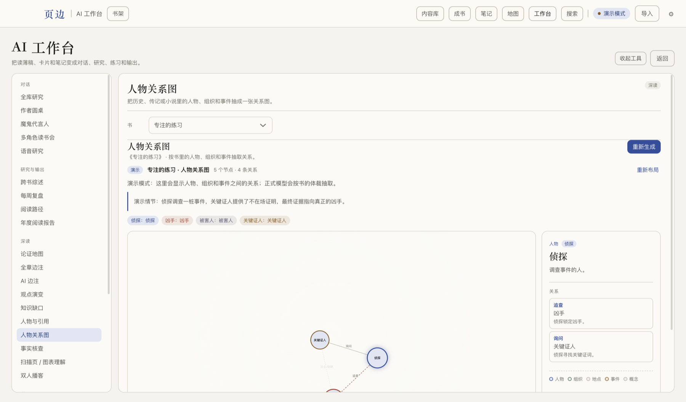

## AI 工作台

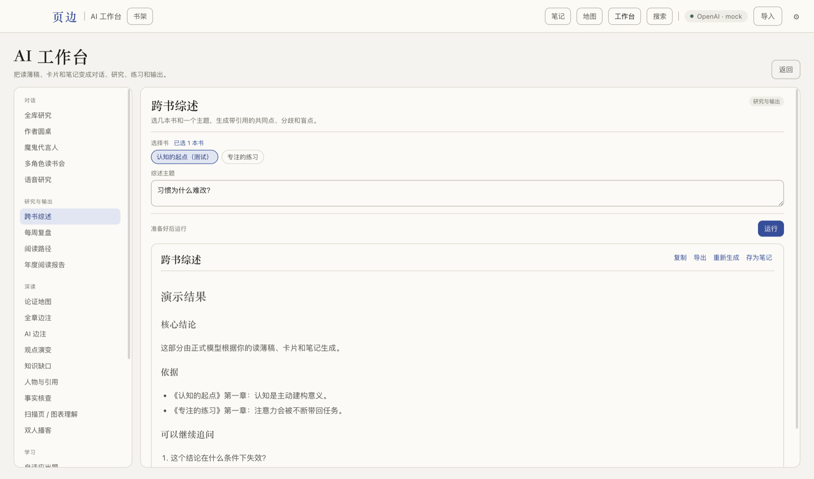

顶栏点「工作台」进入 AI 工作台。它不是再做一个聊天框，而是把现有能力按任务组织起来：

- **研究**：全库研究、作者圆桌、魔鬼代言人、多角色读书会、跨书综述、阅读路径、每周复盘、年度阅读报告。
- **深读**：论证地图、全章边注、AI 边注、观点演变、知识缺口、事实核查、扫描页/图表理解、双人播客。
- **学习**：按章节自适应出题，生成主旨/为什么/比较/应用/反例题并检查自由回答；题目会写明章节名。
- **整理**：概念合并、卡片去重；去重只比较同一章里的知识点 / 论点卡片，跨章相近内容不会被合并。合并会直接更新本地标签或笔记。分享卡回到成书页，不再在工作台重复出现。

大部分工具的输出是 Markdown，可以一键复制、导出或存为摘要笔记；论证地图、阅读路径和时间线会直接给出 Mermaid 代码块，在报告里就地渲染成图；双人播客目前只保留文稿，可复制、导出或存为笔记；扫描页工具会在本机渲染 PDF 页面并用 macOS Vision OCR 后交给 AI 解释。

工作台的报告、聊天、出题、合并建议、去重结果、PDF 页理解和整本成稿都会写入本地 `lab_artifact_versions` 表；报告按书/章节/主题分别保留版本，结果上方有「历史」下拉，第一章和第二章的播客不会互相覆盖。阅读器里的「问这一章」和「讲给我听」也会按章节持久化。切换工具、切换顶栏页面或重启应用后内容仍在；报告、聊天和出题都有「重新生成」，报告会按上次保存的条件重跑。所有 AI 结果都只是草稿，引用仍需核对。

## 搜索与导出

- **搜索**：顶栏「搜索」或 `⌘K` / `Ctrl+K`，支持书名、作者、章节标题、章节正文和笔记内容；结果可以直接跳到书、章节或具体笔记。
- **复制读薄稿**：读薄稿标题栏的「复制」会把当前编辑后的读薄稿写入剪贴板。
- **导出 Markdown**：「导出 .md」选择保存位置，默认文件名是「书名 章节名.md」；勾选「附卡片」会在文末追加核心卡片、在文中的作用、原文依据和延伸。
- **未采纳内容**：只放在笔记面板的报告折叠区，不会混进导出的正文。

## 笔记库

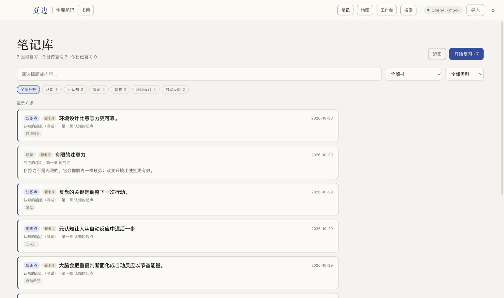

顶栏点「笔记」进入全库笔记库：可以按书、笔记类型和标签筛选，顶部显示当前筛选出的笔记数和书数；点任意一条会回到对应书、章节并定位到那张卡片。笔记库只负责浏览和整理，不做学习打卡。

点「多选」可以勾选 2–12 条笔记，生成一张竖版摘录长图；长图按主题、纸张和字号自动排版，适合一次分享一组卡片。顶部「导出 Markdown」会把当前筛选结果写成带 YAML frontmatter 的 Markdown 文件夹（标题、书名、作者、章节、标签、引用核对状态、来源深链），可以直接放进 Obsidian 仓库或导入 Notion；多选模式下也可以只导出选中的笔记。

## 整本成书

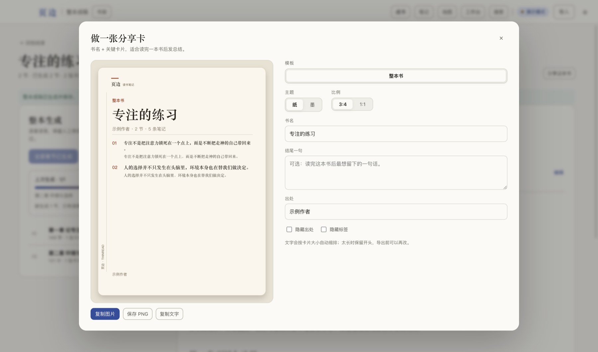

顶栏「成书」或书架卡片上的「成书」进入整本工作区：

- **整本生成**：列出每一节的读薄状态，默认只补还没有读薄稿的章节；也可以确认后整本重新生成。生成逐章串行执行，避免同时打满模型限流；进度和失败章节会实时显示，可以随时取消。人工改过的 AI 笔记不会被覆盖。
- **整本 AI 排版**：在成书页一键逐章排版，自动清理广告、标题和乱码并保存快照；进度和失败章节会显示，也可以取消。
- **一键成稿**：先补全未生成的章节，再自动进入合并；如果所有章节都已有读薄稿，就直接合并。合并会按主题重排、合并重复、补导语和过渡，并做最后一轮去 AI 味润色。可选「精炼版 / 完整版」和「克制准确 / 读者视角 / 有判断」。精炼版目标约为读薄稿的 55%，完整版约为 82%；小书会直接单次终审，大书按约 1.2 万字分组改写并控制每组输出长度。
- **按段重写**：在成稿编辑区或笔记/读薄编辑区选中一段文字，点「重写选中」，只让模型重写这一段；应用前先用行级 diff 对比改写前后，确认后只替换选中范围，保存后进入版本历史。
- **模型对比**：成稿页和笔记面板都可以用另一个模型重跑当前内容，保存为独立快照并直接打开 diff；不会覆盖现有成稿或笔记。
- **成稿版本**：每次合并都会保存为一个版本，顶部「历史」下拉可以回看旧稿；手动编辑后可以另存为新版本，选中旧版本后可点「恢复为当前」把它另存为最新版本。
- **导出**：复制全文、导出 `.md`、导出不依赖外部资源的 `.html` 分享页，或导出 A4 排版 PDF。PDF 使用 Electron 自带 Chromium 的 `printToPDF`，沿用分享页的宋体排版、封面和 Mermaid 内联图，页脚带页码；不额外打包浏览器。HTML 使用 folio 风格的宋体排版，带书名、作者、日期、阅读时长、自动目录、meta/OG 元信息和移动端样式，可以直接放到博客或 GitHub Pages。
- **发布包**：成稿页的「发布包」会生成 `index.html`、`cover.png`（也是 1200×630 的 OG 图）、`metadata.json`、`citation.bib` / `citation.ris` / `citation.txt`、可选的 `notes.md` 和上传说明，打包成 zip，整个文件夹丢到任意静态托管即可发布。引用文件提供 BibTeX、RIS 和 APA 三种格式。封面有纸色、墨色、极简三种样式，和分享页都在本地生成。
- **局限**：合并只使用已有读薄稿，不会回头重读原文；模型润色仍可能改动语气或漏掉细节，导出前建议在预览里改一遍。

## 分享

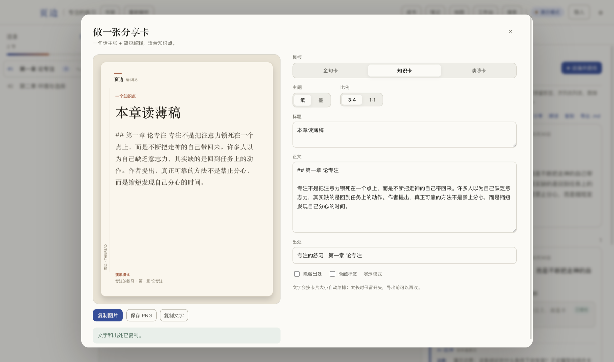

- **入口跟着内容走**：笔记卡片上的「分享」、读薄稿工具栏的「分享」、笔记库每一行的「分享」，以及成书页的「分享这本书」。
- **五种版式**：金句卡（原文摘录）、知识卡（一句话主张 + 解释）、读薄卡（一段完整读薄）、整本书（书名 + 关键卡片）、长图（多选笔记排成一张摘录集）。
- **可调外观**：纸 / 墨 / 苔绿三套主题，3:4 或 1:1 比例；金句、标题、正文、出处都可以在导出前改，也可以隐藏出处和标签。
- **三种输出**：复制图片到系统剪贴板、保存 PNG、复制文字和出处。图片和文字都只在本机生成，不会上传。

## 生成内容库

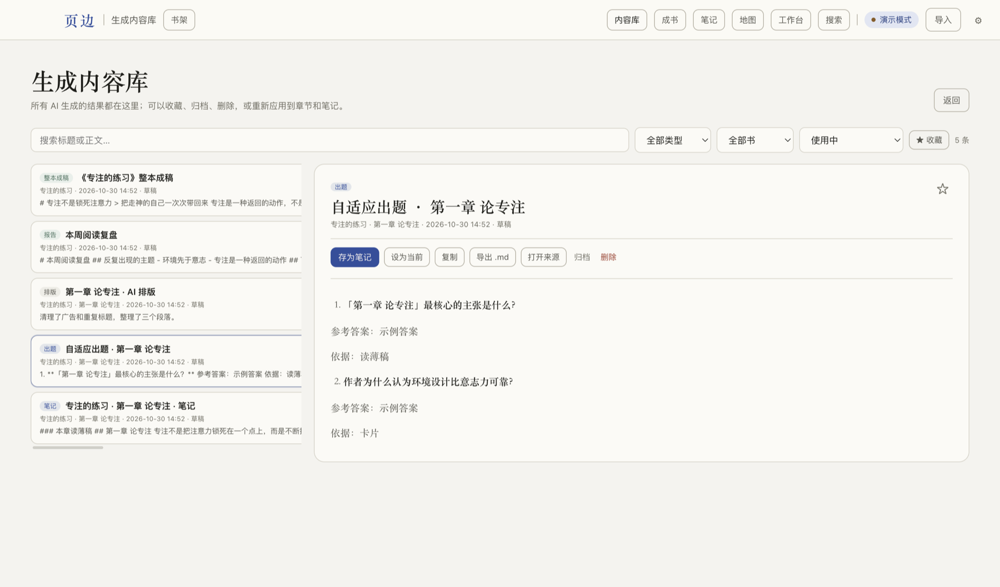

顶栏「内容库」把所有生成结果集中到一个后台页面：

- **保留历史**：工作台报告、对话、出题、费曼、PDF 页理解、整本成稿，以及每次章节笔记和 AI 排版，都会留下独立快照。已归档或放进回收站的内容不会被删除，可以恢复；回收站里也可以彻底删除。
- **筛选与搜索**：按类型、书、收藏、状态（使用中 / 已采用 / 已归档 / 回收站）筛选，也可以按标题和正文搜索。
- **应用**：文本内容可以存为笔记；AI 排版可以直接应用到章节；章节笔记快照可以恢复；出题、对话和整本成稿可以设为当前版本。应用到章节后可以点「撤销上次应用」回到应用前（仅当前进程内）。
- **版本对比**：同一工具、同一范围的历史快照可以点「对比版本」，按行查看新增、删除和未变内容；对比只读，不会修改版本。
- **收藏与整理**：收藏、归档、删除都只作用于生成快照；已经存成的笔记不会被连带删除。
- **知识库的一部分**：内容库里的非删除内容会进入全局搜索，结果按「生成内容」单独分组；点击直接打开对应内容。

生成内容按“一次生成一条快照”保存：答题、继续对话这类编辑会更新当前快照，不会每按一次键就多出一条记录。升级后第一次启动会给已有章节笔记补一份快照；旧版本留下的自动保存记录仍会出现在内容库里，可以归档或删除。

## 数据在哪

macOS：`~/Library/Application Support/reading-notes/`

- `reading-notes.db` — SQLite：书、章节、笔记、语义向量，以及带收藏、状态和来源的生成内容快照
- `books/<id>/source.epub|pdf` — 导入的原始文件
- `settings.json` — 模型配置和加密后的 Key
- `backups/` — 手动/自动备份 zip，包含数据库、书籍文件和设置；恢复会先为当前状态再备份一次
- `ai-traces/` — 按天写入的 AI 步骤 JSONL：步骤、模型、prompt 版本、耗时、token 和错误，不记录正文或 prompt
- `search-index.json.gz` — 全文倒排索引缓存；书、章节或笔记签名变化后自动重建
- `models/` — BGE-small-zh 量化模型缓存（首次建立跨书语义索引时下载，约 23MB）

## 数据校验与迁移

- AI 生成的笔记、关系图和题目在写入前用 zod schema 校验；非法枚举、空正文或超范围的重要度会被拒绝，不会先删掉旧笔记再写入半成品。
- 数据库读取时也会校验笔记，旧库里的非法 kind/author 或损坏 JSON 会降级修复，避免单条坏数据让整章打不开。
- SQLite 使用 `PRAGMA user_version` 和有序迁移；新库直接标记当前版本，旧库在事务里补齐列并升级，失败会回滚。
- 笔记回收站保留 30 天；内容库的“已删除”也保留 30 天，之后自动清理，也可以在回收站里立即彻底删除。启动时会执行 `PRAGMA optimize` 和 WAL checkpoint，不自动做耗时的 VACUUM。
- 每次章节生成会写一条 `ai-traces/` 记录，并带上 `chapter-notes` 总耗时和 `condense / audit / cards / expand` 各步骤的耗时与 token；工作台、问答、排版和整本成稿也会记录顶层耗时和失败步骤。


## 备份与恢复

设置 → 数据备份：

- **立即备份**：把数据库和 `settings.json` 打包到 `backups/`；书文件按内容哈希去重存放在 `backups/blobs/`，多个备份共享同一份，不再每份都复制整库。旧版备份仍然可以直接恢复。
- **自动备份**：合并、拆分、重新解析或删除书籍前自动生成，默认保留最近 8 份；手动备份不会被自动清理。
- **恢复**：选择任意备份，确认后应用会先给当前状态再做一份自动备份，然后替换数据并重新加载窗口。恢复的是完整的书、章节、笔记、生成内容和模型设置。
- **整库导出/导入**：「导出整库」生成完整 zip；「导入整库」选择外部 zip，校验后恢复并重载。导入前会自动备份当前状态，失败不会静默覆盖。
- **应用锁**：设置 →「应用锁」可开启本地密码锁；下次启动先锁定，验证后才加载书籍、笔记和设置。忘记密码只能手动删除 `settings.json` 里的 `lock` 字段。
- **诊断包**：设置 → 数据备份 →「导出诊断包」，把版本、系统信息、最近日志和脱敏后的模型设置打成 zip，用于反馈问题；不包含书籍正文、笔记内容、提示词或 API Key。
- 备份里的 API Key 仍是系统钥匙串加密后的密文；换机器恢复时通常需要重新填写 Key。

## 项目结构

```text
electron/
  main.ts             主进程入口、窗口、开发验证模式
  ipc.ts              渲染层与主进程的 IPC 契约实现
  db.ts               SQLite 存储、版本化迁移、书 / 章节 / 笔记 / 章节标记 / 排版结果
  pdf.ts              Electron printToPDF：分享页 HTML → A4 PDF
  eval-real.ts        真实模型固定样例评测
  import.ts           解析、自动清理并写入一本书
  settings.ts         模型配置与 Key 的本地存储
  html.ts             HTML 清洗、文本提取、图片占位与还原
  reader-style.ts     阅读样式配置的归一化与持久化
  ai/provider.ts      AI SDK provider 构造
  ai/notes.ts         读薄、断言回查、核心卡片、有限延伸
  ai/classify.ts      章节识别：本地规则 + AI 分类
  ai/format.ts        AI 排版：结构化输出、移除核对、内容完整性校验
  ai/tutor.ts         章节问答、苏格拉底追问、费曼自测评估
  ai/lab.ts           AI 工作台：研究、作者圆桌、综述、论证、出题、合并与关系图
  ai/book-compose.ts  整本成稿：分组改写、统一润色、去 AI 味与长文组装
  ai/trace.ts         AI 步骤 JSONL trace：耗时、token、模型与错误
  ai/provider.ts      AI SDK provider 构造
  semantic.ts         本地语义索引：BGE-small-zh 嵌入、增量索引、跨书相关笔记
  knowledge-map.ts    知识地图：书/概念节点、概念共现与书归属连边
  backup.ts           数据库快照、书籍/设置打包、自动备份与恢复
  scripts/pdf-page.swift  PDF 单页渲染 + macOS Vision OCR
  scripts/pdf-ocr.swift   扫描版 PDF 逐页渲染 + Vision OCR
  parsers/pdf-ocr.ts      扫描版 PDF OCR 导入与进度
  parsers/highlights.ts   Readwise CSV / Kindle 划线解析
  parsers/epub.ts     EPUB 解析（OPF / spine / 图片内联 / 清洗）
  parsers/mobi.ts     MOBI / KF8 解析：目录、章节和 HTML
  parsers/text-book.ts 纯文本 / 网页正文切章
  parsers/url.ts      网页抓取与正文抽取
  parsers/pdf.ts      PDF 文字层提取与分页
  preload.ts          contextBridge 暴露的 window.api
shared/types.ts       主进程与渲染层共享的类型和 provider 预置
shared/schemas.ts     zod 运行时 schema：AI 笔记、笔记、关系图、题目
src/
  App.tsx             应用状态与流程编排
  components/         书架、阅读器、笔记、成书、分享、内容库、回声、听读、地图、AI 工作台、搜索、排版、设置
  lib/lab-tools.ts    AI 工作台的任务目录与输入配置
  lib/share-card.ts   分享卡的版式、长图与 Canvas 渲染
  lib/xhs-carousel.ts 小红书图文的分页规划与 3:4 Canvas 渲染
  lib/mermaid*.ts     Mermaid 渲染与自包含 HTML 内联 SVG
  src/stories/        Storybook 隔离预览与主题装饰器
  lib/blog-export.ts  整本成稿的自包含 HTML 导出
  lib/content-view.ts 生成内容库的预览转换与类型标签
  lib/export.ts       读薄稿的 Markdown 组装与文件名
  lib/links.ts        反向链接与相关笔记
  styles.css          纸感主题
```

## 设计取舍

1. **笔记是 block 级的，不是一篇可覆盖的 Markdown。** 每条笔记记录来源、作者（AI/我）、是否被人工编辑、引用的原文。这是「AI 自动生成」和「用户边读边改」能共存的前提。
2. **章节也带来源标记和篇归属。** 每一章记录分类（正文/目录/版权页…）、是否隐藏、由规则还是 AI 判断，以及属于上篇/下篇。篇是目录里的分组，不是章节本身；篇首页有内容时单独成为「篇首页」。
3. **目录页整页保留，不逐条拆开。** 目录页被识别为 nav 后自动隐藏；只有真正的章级标题才切分，避免把目录条目和小节混进章节列表。
4. **先读薄，再提炼卡片，最后才延伸。** 按断言重写并自动决定压缩幅度，卡片只从读薄稿里按压缩后字数提炼；不再用逐句提取制造卡片墙，也不在原文上发散。
5. **引用必须可校验。** 生成结果的每条引用都要在本章正文里做规范化匹配；匹配不上就标记未核对。读书笔记最怕的不是总结得平庸，而是编造原文。
6. **笔记链接分三层。** 显式 `[[标题]]`、自动反向链接、本地语义向量带来的同书/跨书相关笔记。图谱视图以后再做，先把「写笔记时能看到相关旧笔记」做好。
7. **AI 排版只动显示层。** 清理结果单独存进 `formatted_html`，原文永远保留；样式偏好是结构化配置，不让模型生成任意 CSS。删除的每一段都要能在原文里核对，改动过大会被拒绝。
8. **本地优先。** 解析、存储、检索都在本机；笔记内容不会离开设备，外部请求只有模型调用和首次下载语义模型。
9. **读薄稿和生成说明分开。** 未采纳内容、审计补遗属于生成报告，不进入导出的正文；导出的 Markdown 只保留能直接发布的内容。
10. **跨书关联用本地向量，不把笔记发出去。** 笔记标题、标签和正文在本机用 BGE-small-zh 计算向量并缓存；模型缺失或首次下载时自动回退到标签匹配，界面不会因此空白。
11. **阅读现场的 AI 有边界。** 问答和自测只使用当前章节、读薄稿和卡片；引用会做原文核对，对不上就标记「待核对」，不假装是书中原话。
12. **回声和听读都不改原文。** 回声只读取本地笔记和语义向量；听读只读当前内容，不会生成新文本或改写正文。
13. **知识地图是导航，不是本体论。** 概念图里的节点是笔记标签，连线是概念在同一篇笔记中共现或同属一本书；它帮你发现相邻主题，不代表概念之间存在严格的定义关系。
14. **AI 工作台是编排层，不是新的事实来源。** 它把书、读薄稿、卡片和笔记交给模型生成对话、研究和输出；每个结果都标为草稿，引用仍应回到原文核对。
15. **整本成稿不是把章节拼起来。** 小书直接单次终审；大书先按约 1.2 万字分组改写，每组有明确字数上限，再做一次全书终审。终审失败时仍交付已整理的稿子，不把整次生成作废。
16. **分享是笔记的出口，不是另一个工作台。** 分享入口放在用户正在看的内容旁边；卡片是本地 Canvas 渲染，图片和文字导出都不经过服务器。
17. **生成内容是一等资产，不是临时输出。** 每次生成都有来源、状态和版本；答题等编辑更新当前快照，重新生成才产生新版本。内容库负责找回、应用和清理，搜索负责让它进入知识库。

模型接入和文档解析参考了 `x-code-cli` 的 provider catalog、`readDocument` 的格式覆盖思路，以及 Electron 的 main / preload / renderer 分层做法。

## 开发验证

```bash
pnpm typecheck                 # 渲染层 + 主进程类型检查
pnpm build                     # esbuild 主进程 + vite 渲染层
pnpm test                      # 固定回归测试：划线、OCR 切章、发布包、分类、关系图、全文索引、备份恢复、schema 校验、迁移升级和演示生成评测
pnpm test:ui                   # 构建后启动无头 Electron，回归书架、搜索、阅读器划词/听读、双人播客文稿、笔记编辑、地图、导入和分页
pnpm test:ui:pdf               # 用一页 PDF 回归原版版式查看、翻页和缩放
pnpm test:packaged             # 对 release/mac-*/*.app 跑打包产物冒烟
pnpm test:e2e                  # 可选：用设置里的真实模型跑一遍读薄 + 成稿 + 双人播客（会消耗 token）
# 真实书稿多章评测结果见 docs/real-book-eval-v7.json 与 docs/ai-baseline.json
pnpm eval:real                 # 可选：用 3 个固定章节跑真实模型质量评测，输出卡片数、引用校验率和 token
node_modules/.bin/electron . --smoke-test
```

AI 录制 / 回放（用于没有 API Key 的 CI）：

```bash
# 用真实模型跑一次并录制响应（会消耗 token）
THINREAD_AI_RECORD_DIR=/tmp/ai-fixtures pnpm eval:real
# 不联网、不配置 Key，回放录制好的响应
THINREAD_AI_REPLAY_DIR=/tmp/ai-fixtures pnpm test
```

翻译清单：

```bash
pnpm manual            # 重新生成 docs/user-manual.html/pdf，并同步应用内嵌版
pnpm i18n:inventory   # 统计渲染层中文字面量，输出 docs/i18n-inventory.json
```

`--smoke-test` 会无头跑一遍 EPUB 解析、SQLite 写入和演示生成，输出结构化结果后退出。无障碍检查由 axe-core 注入到 UI 冒烟，扫描 WCAG 2A/2AA 的 critical/serious 问题；关系图、地图搜索、回收站和 PDF 导出入口也在检查范围内。

打包：

```bash
pnpm run pack      # 只生成 macOS 的未签名应用目录
pnpm dist:mac      # macOS dmg + zip（不签名、不公证）
```

产物在 `release/`；推送 `v*` tag 会触发 `.github/workflows/release.yml` 只构建 macOS 产物。项目不做签名和公证，首次打开可能需要在系统设置里手动允许。

界面验证可以用开发模式参数：

```bash
# 用临时数据目录播种一本演示书，打开第一本并截图
node_modules/.bin/electron . --data-dir=/tmp/rn-demo --seed-demo --open-first \
  --screenshot=/tmp/reading-notes.png
```

## 开发预览

分享卡、阅读器、书架、笔记卡片、知识地图、人物关系图、小红书图文和听读面板可以用 Storybook 隔离预览，不必启动 Electron：

```bash
pnpm storybook
```

构建静态 Storybook：

```bash
pnpm build-storybook
```

生成一组关键 story 的截图基线；再次运行并加 `--check`（`pnpm capture:storybook -- --check`）会逐像素比较并允许少量抗锯齿差异，布局或文案变化超过阈值时失败，用于本地和 CI 视觉回归：

```bash
pnpm capture:storybook
```

截图和 `manifest.json` 一起放在 `storybook-screenshots/`，需要提交到仓库；CI 的 macOS 任务会在构建 Storybook 后运行 `pnpm capture:storybook -- --check`，逐像素比较失败时会保留本次截图到 `storybook-screenshots-current/` 方便查看。改动了预期内的界面后，重新生成基线并一起提交。

README 里的产品截图放在 `docs/`，Storybook 视觉基线放在 `storybook-screenshots/`；两者都是本地生成的静态图片。

知识地图和人物关系图都使用 `@xyflow/react` 承担缩放、拖拽、minimap 和边选择，`d3-force` 只计算初始布局坐标；`html-to-image` 负责把完整节点范围导出成 PNG，Markdown 中的 `mermaid` 代码块会在应用内渲染，自包含 HTML 导出时也会内联 SVG。

## 已知限制 / 下一步

- PDF 默认是文字层重排阅读；阅读器顶部的「原版 PDF」会打开 PDF.js 原始版式查看器，便于核对分栏、图表和排版。扫描版 PDF 需要用「扫描版 PDF（OCR）」入口，普通 PDF 入口只会读取文字层。
- Readwise 同步现在会独立尝试 v2 导出和 Reader v3 文档列表并合并去重；其中一个来源没有权限或返回 404 不会阻断另一个。Reader-only Token 也能同步，CSV 导入仍然保留。
- EPUB 单张图片上限 4MB、整本 20MB；MOBI 会把解析器导出的章节图片内联为 data URL（单张 2MB、整本 12MB 上限）；网页导入会下载正文图片并内联，失败的图片会跳过。DRM 加密文件仍无法读取。
- 手动粘贴和网页导入使用标题规则切章；如果文章没有可识别标题，会作为一章导入，之后可以在阅读器里手动改名。
- 导入时的自动清理使用本地规则，不调用模型；AI 识别在「整理目录」里按需执行，避免导入变慢和产生额外费用。
- 重新解析会重建章节。无法匹配到新章节的笔记会保留下来，但不再显示在章节里；已有的 AI 排版结果会被清空，需要重新整理。
- AI 排版需要真实模型，演示模式只能调整样式滑杆；超过约 6 万字符的超长章节第一版会直接提示不支持。长章节会按约 14k 字分段请求，单段超时或失败时保留该段原文并提示。
- AI 仍可能过度删除。移除清单、内容完整性校验和「还原原文」是三道保险；不满意可以逐条保留或整体回退。
- 不同模型的结构化输出差异较大。笔记生成会先尝试流式宽松解析，字段名或类型不一致时会归一化；失败后回退到纯文本 JSON 解析。AI 排版不强制 provider 的 structured output，会从文本 JSON 归一化字段长度和样式范围；仍无法解析时保留原文，并在整本任务里列出失败章节供重试。
- 听读使用千问 TTS（阿里云百炼）。
- 已有 electron-builder 配置和 GitHub Actions 发布流程；当前只构建 macOS 的 `pnpm dist:mac`，产物不签名、不公证。Windows/Linux 暂不发布。
- 读薄、卡片和延伸都依赖模型。AI 判断的压缩幅度或卡片数量不合适时，可以换更强的模型重跑；读薄稿会显示审计补遗，未采纳内容也会单独列出。
- 保真审计是 AI 对照原文和读薄稿做的，不是形式化证明。它用来发现明显遗漏，不保证每个隐含意思都被显式写出。
- 跨书语义关联会在首次使用时下载约 23MB 的 BGE-small-zh 量化模型，默认走 `hf-mirror.com`，可以用 `HF_ENDPOINT` 换成其他 Hugging Face 镜像；下载失败时自动回退到标签/关键词匹配。
- 语义索引在 CPU 上运行，笔记很多时首次建索引需要一点时间；之后只增量计算新增或修改过的笔记。
- 全局搜索使用关键词倒排索引 + 本地语义检索，关键词结果先显示，语义结果随后用 RRF 融合；倒排索引缓存到 `search-index.json.gz`，签名变化时重建。单字或纯标点查询会回退到 `LIKE`，超大书库首次构建仍会占用一定内存。
- 问答和自测依赖真实模型；演示模式只返回固定的示例回答。章节问答和费曼结果按章节保存在本地，切换章节会加载对应记录。
- 听读使用千问 TTS（阿里云百炼 `qwen-audio-3.1-tts-flash`）。需要在设置里配置 Key，或先配置阿里云百炼主模型复用同一把 Key；按字符计费。
- 笔记库每页 30 条，筛选、总数和分页都在数据库里完成。
- 整本生成按章节串行执行；章节很多或模型较慢时，一本长书可能要跑很久。可以先小范围生成，或随时取消。
- 整本合并按约 7000 字一组改写；超长书会拆成多组，再单独写导语和结尾，统一性不如一次终审，但不会超出模型上下文。
- 合并只读取已有读薄稿，不会回头逐字核对原文；润色后的稿子仍需人工过一遍。
- HTML 分享页是纯文字排版，不包含书里的插图；需要图片时用分享卡或手动补图。
- 排版 PDF 走 Chromium 打印，超长 Mermaid 图或复杂表格可能跨页断开；导出后建议检查分页和页脚页码。
- 固定的 AI 评测目前用演示模式检查流程不变量；真实模型的引用质量可以跑 `pnpm eval:real`（需要配置 Key，会消耗 token），`ai-traces/` 只记录元数据，不保存模型输入输出。
- 分享卡使用系统字体（宋体 / 苹方）绘制；在缺少这些字体的系统上会自动回退，版式可能略有差异。
- 笔记库多选长图最多 12 条；超出的部分不会进入这一张图。
- 知识地图一次从最近/最重要的 300 条笔记里提取最多 60 个概念；无标签笔记会汇总到「未归类」节点，未进入前 60 个概念的标签笔记仍在搜索和笔记库里。
- 知识地图的布局是力导向的，默认稳定、点「重新布局」才换位置，但它不是严格的概念层次图；概念连线只表示同一篇笔记内的共现或同属一本书。
- 知识地图的概念连线来自标签共现，不依赖语义模型；语义索引只用于页边回声和跨书相关笔记。
- AI 工作台的大部分工具依赖真实模型；演示模式返回固定示例。长报告、作者圆桌和综述会消耗较多 token，建议先选较少的书/章节。
- 人物关系图会先用本地全文扫描覆盖章节里的角色候选和原文窗口，再分两步抽取节点和关系；模型仍不是逐字读完整本，只出现一次且没有对话/笔记痕迹的极冷门名字仍可能漏掉；关系边这一步失败时会保留已抽出的节点名单。真实人物/地点的百科背景来自模型常识，不是经过核对的资料，使用时请自行确认。
- 读薄的断言回查为了控制 token，只检查章节前 24k 字；超长章节的尾部可能不在回查范围内。
- AI 排版会把长章节按约 14k 字分段处理；个别分段失败时会保留该段原文，并在结果说明里提示。
- MD 和超过大小上限的 EPUB/MOBI/网页图片不会进入正文。
- 界面目前以中文为主；设置里可以切到 English（Beta）。主要界面已完成英文；导出 Markdown / HTML / 发布包文案会跟随界面语言，书籍正文和笔记内容保持原文。`pnpm i18n:inventory` 会统计尚未包进 `t()` 的文案。
- 整章音频导出使用千问 TTS，会先确认段数和字符数，再逐段请求合成后合并；导出为原速 WAV，长章节会产生相应的字符费用。
- 小红书图文的「原书覆盖检查」会调用当前笔记模型，结果是辅助性的漏点提示，不是形式化证明；补漏卡只进入本次导出，不写回笔记。
- 阅读位置按章节保存；PDF 原版查看器按页查看，并会记住上次页码。
- 扫描页/图表理解目前按 PDF 单页处理，使用 macOS Vision OCR；它能读文字和图表标签，但不是完整的视觉模型，也不会在导入时自动 OCR 整本扫描书。
- 工作台生成的报告存为笔记时会挂在所选书（或第一本书）下；概念合并、卡片合并会直接修改本地数据，暂不支持撤销。
- 合并书籍会移动章节和笔记并删除其他源书；拆分后的新书使用文本快照，两本书都可以重新解析。
- 工作台报告按来源保留版本，历史下拉最多显示最近 40 个版本；对话和出题每次新生成是一份快照，答案编辑更新同一份；合并/去重保留每次扫描建议。所有快照都可以在内容库回看。
- 卡片去重只接受同章、同书的知识点 / 论点卡片，并同时检查语义相似度和正文重合；跨章相近内容只算相关，不会进入合并队列。
- 生成内容库的快照按生成次数保留；旧版本在引入“一次生成一条快照”之前留下的自动保存记录可能较多，需要手动归档或删除。
- 内容库搜索优先复用全局全文索引，索引不可用或查询过短时回退到标题/正文 `LIKE`；知识地图仍然只使用笔记标签。
- 删除生成内容会进入回收站，彻底删除后无法恢复；已经存成的笔记、已经应用到章节的排版不会随之回滚。应用到章节可在当前进程内点「撤销上次应用」，重启后撤销记录不保留。
- 分享卡和小红书图文是即时生成的图片，目前不进入内容库；需要长期保存时请导出 PNG。
- 阅读器章节问答和费曼按章节保存；工具默认加载最新一份，旧快照可以在内容库切回。

## 安装包与 Release

最新 macOS 未签名安装包见 [Releases](https://github.com/qweijiaq/ThinRead/releases)。当前 v0.1.3 是内测预发布，提供 arm64 app zip 和完整内测 bundle；不做签名和公证，首次打开需要在系统设置里手动允许。v0.1.0 是第一个公开安装包。

推送 `v*` tag 的发布流程有一道硬门禁：先跑 `pnpm typecheck`、`pnpm test`、渲染层与 PDF 冒烟，并校验 tag 与 `package.json` 的版本号一致，通过后才复用同一份构建产物打包。发布 job 会上传 dmg、zip 和 blockmap（增量更新需要）。

签名是可选的：仓库里配好 `MAC_CERT_P12`（Developer ID 证书的 base64）、`MAC_CERT_PASSWORD`、`APPLE_ID`、`APPLE_APP_SPECIFIC_PASSWORD`、`APPLE_TEAM_ID` 后，会自动签名并公证；没有密钥时保持 ad-hoc 签名的未签名产物，流程不中断。未签名构建的自动更新默认关闭（`THINREAD_UPDATER=1` 可临时开启验证），因为 macOS 的 Squirrel 要求有效签名，否则只会后台下载几百 MB 再失败。

## Roadmap

- [x] 本地优先的 EPUB/PDF/MOBI/网页导入、读薄、卡片、跨书回声和知识地图
- [x] 章节问答、费曼自测、AI 工作台、分享卡、小红书图文、Markdown/HTML/PDF 导出
- [x] zod 边界校验、版本化 SQLite 迁移、AI trace、固定样例评测和 Storybook 视觉基线
- [x] macOS 未签名安装包（v0.1.0）
- [x] v0.1.3 内测包（校准供应商预设；0.1.2 加入文章复制全文；0.1.1 加入圆角图标、首次引导、成本确认、内嵌手册）
- [ ] 30–60 秒演示 GIF
- [ ] 英文 README 和更完整的同类工具对比
- [ ] Windows/Linux 实机验证（暂时不做）

## 更新记录

- **2026-11-06**：发布 v0.1.4 macOS arm64 内测包；加入阅读计划、应用锁、笔记审计/导出、版本 diff、按段重写、周复盘独立存储、千问 TTS 音色与 MP3/段落间隔、分享卡和小红书 daily-post 视觉重构；补齐开源协作文档和 CI 可移植性。
- **2026-11-03**：发布 v0.1.3 macOS arm64 内测预发布包，校准 DeepSeek / 智谱 / Kimi / Anthropic / 阿里云百炼的 Base URL 和 Key 入口。
- **2026-11-03**：发布 v0.1.2 macOS arm64 内测预发布包，为章节、读薄稿、成书、报告、周复盘等文章加入「复制全文」。
- **2026-11-03**：发布 v0.1.1 macOS arm64 内测预发布包，加入首次引导、成本确认、内嵌手册和圆角图标。
- **2026-11-01**：发布 v0.1.0 macOS arm64 未签名安装包；补充笔记回收站、PDF 页码记忆、AI 流式回答、持久化搜索索引、MIT License 和 macOS-only 发布流程；增加 DeepSeek 固定样例评测与无障碍检查。
- **2026-11-01（main）**：增加章节回收站、崩溃安全任务恢复、笔记依据核查、关键词/语义 RRF 融合搜索、发布包 BibTeX/RIS/APA 引用、`thinread://` 深链和打包产物冒烟。

## 反馈与参与

- 问题、功能建议和评测样例：[GitHub Issues](https://github.com/qweijiaq/ThinRead/issues)
- 开发环境、测试和提交约定：[CONTRIBUTING.md](CONTRIBUTING.md)
- 安全问题请走私密报告：[SECURITY.md](SECURITY.md)
- 社区行为准则：[CODE_OF_CONDUCT.md](CODE_OF_CONDUCT.md)

当前是 `0.1.x` 公开 beta：核心阅读、笔记、成书、分享和本地数据链路可用；同步、数据库加密、跨平台 OCR 和完整英文仍是后续工作。

最近更新：2026-11-06

## License

MIT，见 [LICENSE](LICENSE)。
