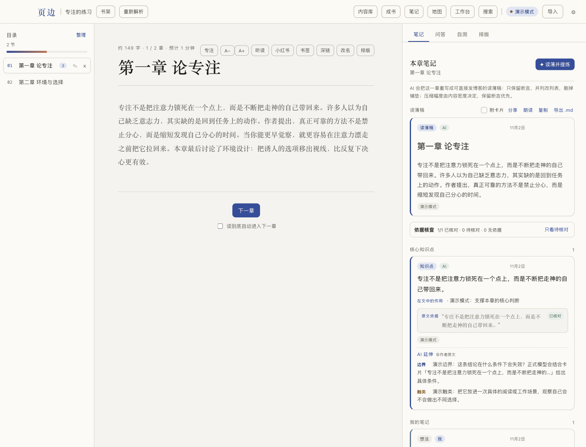
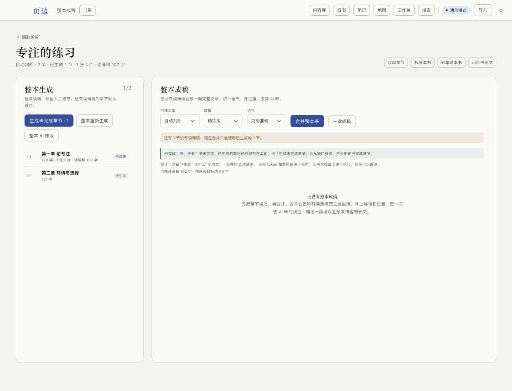
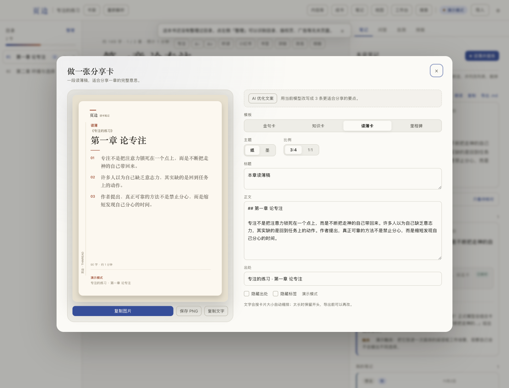

<p align="center">
  
</p>

<h1 align="center">ThinRead</h1>

<p align="center">
  <a href="LICENSE"></a>
  <a href="#build-from-source"></a>
  <a href="https://github.com/qweijiaq/ThinRead/releases"></a>
  <a href="https://github.com/qweijiaq/ThinRead/actions/workflows/ci.yml"></a>
</p>

<p align="center">
  <strong>English</strong> · <a href="README.zh-CN.md">简体中文</a> · <a href="website/">Website</a> · <a href="docs/user-manual.md">Manual</a> · <a href="https://github.com/qweijiaq/ThinRead/releases">Releases</a>
</p>

> Most reading tools optimize for **capture**: more highlights, more excerpts, a bigger library.
> ThinRead optimizes for **output**: when you finish a chapter, you should have a draft you can publish.

ThinRead is a local-first AI reading workbench. It rewrites each chapter of a book into a publishable draft that keeps every argument, distills core cards that actually change how the chapter is understood (roughly 3–6 per 1,000 characters, more for long chapters), and connects those cards and notes to the rest of your library through a local semantic index.

Import EPUB / PDF / MOBI / web pages / WeChat Reading / Readwise / Kindle clippings. Export Markdown, self-contained HTML, print-ready PDF, or a complete publishing bundle.

Electron + React + TypeScript. Your data stays on your machine. MIT licensed.



---

## Why "thin" reading

Finish a book and three things usually survive: **what the author actually claimed**, **which concepts hold that claim up**, and **how it relates to what else you've read**.

Mainstream tools each solve half of that. Highlight tools nail capture, but the output is still fragments that need a second pass. Note tools nail storage, but cross-book links are manual. Q&A tools nail retrieval, but the answer evaporates once you close the tab.

ThinRead inverts the order: **define the artifact first, then work backwards to the reading process.**

- The artifact is a publishable draft, so condensing is not summarization — it is a rewrite organized around claims.
- The artifact must be reusable, so cards are distilled from the condensed draft, never sprayed out of the raw text.
- The artifact must be connectable, so cross-book linking runs on local embeddings instead of uploading your notes.

The pipeline is enforced: **condense → cards → bounded extension**, no skipping. Skip a stage and you are back to "summary plus a pile of highlights", which is the thing this app exists to avoid.

---

## Three core capabilities

**Condense into a draft**
Not a page-by-page summary. The model identifies every place the author makes a claim, separates claims from evidence and filler, and rewrites the chapter around that structure. Compression is decided by content density, targeting at most half the original length. The result is editable, re-runnable, and exports to Markdown / HTML / PDF.

**Core cards**
Cards are distilled from the condensed draft and scale with its length rather than the original's (roughly 3–6 per 1,000 characters, capped at 80 as a safety limit). Every card states the point, its role in the chapter, and a verbatim citation that must be findable in the chapter. No citation, no card — the model is never allowed to pass its own paraphrase off as the author's words.

**Cross-book knowledge graph**
Note titles, tags, and bodies are embedded locally with BGE-small-zh and cached. Related notes from other books surface as margin echoes, a concept map, a character graph, and chapter-scoped Q&A — turning "what did this book say" into "how does it connect to what I've read".

---

## Product tour

| Library | Reading & notes | AI workbench |
| --- | --- | --- |
|  |  |  |

| Book composition | Share cards | Social carousel |
| --- | --- | --- |
|  |  |  |

More screens and reading statistics: [feature gallery](docs/features/README.md).

---

## Engineering

The product promises two things — local-first data and verifiable citations. Both are architectural constraints, not marketing copy.

### The data boundary is architecture, not a privacy statement

Parsing, storage, retrieval, and rendering all happen on-device. There are exactly two outbound paths: a model call you explicitly trigger, and the one-time ~23 MB quantized embedding model download.

- Books, chapters, notes, and generation history live in local SQLite
- API keys are encrypted in the system keychain, falling back to a `0600` file
- Embeddings are computed locally; note content never leaves the machine
- AI traces record step, model, latency, tokens, and errors — never bodies or prompts

### A reliability layer around model output

Model output is untrusted, so every generated artifact passes a verification gate.

- **Citation verification** — quoted text must normalize-match the chapter; otherwise it is marked unverified
- **Content integrity** — formatting results are diffed against "original minus removed segments"; over-editing rejects the whole run
- **Structured output normalization** — lenient streaming parse, field/type normalization, then a plain-text JSON fallback
- **No half-written state** — zod validates before writes; invalid payloads are rejected rather than clobbering good notes
- **Reversible** — formatting is stored separately in `formatted_html`; the original HTML is never destroyed

### Data integrity

- Ordered SQLite migrations via `PRAGMA user_version`, applied in a transaction with rollback on failure
- Notes are validated on read too; malformed enums or corrupt JSON are repaired so one bad row cannot lock a chapter
- 30-day recycle bins for books, chapters, notes, and generated artifacts
- Automatic backups before merge, split, reparse, or delete; book files are content-hash deduplicated across backups

### Performance and cost

- Condensing runs concurrently across sections (4-way by default); claim audit and card extraction run in parallel
- Results are cached for 14 days by content hash across chapter + model + quality tier — cache hits cost 0 tokens
- Deep mode reuses a 24k-token source prefix (explicit Anthropic `cache_control`; automatic prefix caching on OpenAI-compatible endpoints)
- Short chapters, low compression ratios, and small card sets skip the stages that would not pay off
- The full-text index is cached to `search-index.json.gz` and loaded directly when signatures are unchanged
- Generated snapshots are pruned to the latest 30 per tool + scope; favorites and the current version are never pruned
- Failed model requests retry with exponential backoff, only for recoverable errors such as 429, 5xx, and timeouts

### Verification

- 266 regression tests covering highlight parsing, OCR chaptering, publishing bundles, classification, relation graphs, full-text index, backup/restore, schema validation, and migrations
- Headless Electron smoke tests for library, search, selection actions, TTS, note editing, maps, import, and pagination
- Storybook pixel baselines with CI diffing — layout drift fails the build
- axe-core injected into UI smoke tests, scanning WCAG 2A/2AA critical/serious issues
- CI runs without an API key: record real model responses once, replay them afterwards
- `check:boundaries` blocks renderer imports of Electron or Node built-ins, enforcing the architecture boundary in CI

---

## How it differs

| | ThinRead | Readwise Reader | Obsidian | NotebookLM |
|---|---|---|---|---|
| Core focus | Turn books into publishable drafts, cards, and cross-book links | Capture, read, and review highlights | General bidirectional-link knowledge base | Q&A, summaries, and audio over a corpus |
| Output per book | Draft, core cards, Q&A, share cards / PDF | Highlights, notes, reviews | Notes, links, plugins | Answers, summaries, audio |
| Cross-book | Local semantic echoes + concept map + character graph | Mostly tags and reviews | Manual links or plugins | Mostly within the current corpus |
| Data location | Local SQLite + files | Cloud | Local files | Cloud |
| Best for | Deep reading of nonfiction that continues into writing | High-volume capture and review | Maintaining your own knowledge system | Quickly understanding a set of sources |

This is a positioning difference, not a feature checklist. ThinRead does not replace your reader and does not try to be a full knowledge base. It focuses on one question: **after finishing this chapter, what reusable thing is left?**

---

## For platforms and developer programs

ThinRead is a shipped independent product with a full feature surface and real engineering constraints — not a prototype. If you run a developer program, model platform, or app distribution platform, here is the integration surface you can actually evaluate.

**What already exists**

- A complete loop: import → read → condense → cards → compose → share / export
- A clear local/cloud boundary: which capabilities must stay on-device and which can be hosted is already separated in the architecture
- A replaceable model layer: OpenAI-compatible endpoints plus native Anthropic and Qwen TTS, with 10 built-in provider presets
- An engineering baseline: typecheck, 266 regression tests, renderer and PDF smoke tests, pixel baselines, accessibility scans, and key-free AI record/replay
- Genuine long-tail inputs: a 392-page PDF, scanned-page OCR, code-block reconstruction, multilingual typesetting — not a toy dataset

**Honest porting assessment**

- Reusable: the React renderer, prompt and three-stage generation pipeline, card and citation verification logic, share and export rendering
- Needs rewriting: the Electron main process, SQLite storage, filesystem access and OCR, `printToPDF`
- Conclusion: this is not "wire up an SDK". It is a platform port. Any partnership should be scoped that way, not estimated as "publish an app".

**What a partnership could look like**

- Platform side: runtime, managed storage, persistent memory, and a distribution channel
- Project side: a real, deeply-used AI application brought onto the platform, serving as a case study for a hybrid "local-first + cloud capability" architecture
- Metrics both sides can verify: real usage, retention, per-chapter generation cost, citation pass rate

**Contact**: GitHub Issues, or the contact details on the [website](website/).

---

## Quick start

Requires Node >= 22 and pnpm 10+:

```bash
pnpm install
pnpm dev
```

The first launch shows an empty library. Click **Import**, pick an EPUB or PDF, keep **Demo mode** on in the top-right, open the book, and click **✦ Condense** to see the whole flow — no API key needed.

No book handy? Import [samples/sample.epub](samples/sample.epub) (a two-chapter sample). To use a real model, see [Connecting a model](#connecting-a-model).

> macOS builds are published on [Releases](https://github.com/qweijiaq/ThinRead/releases). They are unsigned and not notarized.

**First run path**: import a book → open a chapter → **✦ Condense** → review the core cards → **Compose**.

**Vocabulary**: **condense** = rewrite a chapter into a publishable article; **card** = a concept that changes how the chapter is understood; **compose** = merge every condensed chapter into one long-form piece; **echo** = a semantically related note from another book.

**Who it is for**: people reading nonfiction, history, and research material who want a book to become an article, a set of cards, or shareable content; people with an existing library who want cross-book connections back; people who prefer their data on-device and their own model keys.

**Who it is not for**: people who want a plain reader with no AI; people who need mobile or real-time collaboration; people unwilling to configure an API key or a local model. Only macOS is verified today.

---

## Build from source

If the Electron binary download is slow, set a mirror first:

```bash
ELECTRON_MIRROR=https://npmmirror.com/mirrors/electron/ pnpm install
```

pnpm 10+ blocks dependency build scripts by default; `pnpm-workspace.yaml` already allows `electron` and `esbuild`.

Production build:

```bash
pnpm build
pnpm start
```

Packaging:

```bash
pnpm run pack      # unsigned app directory for the current platform
pnpm dist:mac      # macOS dmg + zip (unsigned, unnotarized)
pnpm dist:win      # Windows NSIS installer
pnpm dist:linux    # Linux AppImage
pnpm dist:all      # build all three platforms (run on each OS or in a CI matrix)
```

Artifacts land in `release/`. Pushing a `v*` tag triggers `.github/workflows/release.yml`, which builds macOS artifacts only.

---

## Connecting a model

Settings → pick a provider → fill in Base URL, model, and API key → **Test connection**. The model field suggests candidates per provider; once a key is set you can **Refresh models** and pick from a searchable list, or paste any model ID.

Presets include DeepSeek, Zhipu GLM, Anthropic, OpenAI, Moonshot, Alibaba Cloud Bailian, OpenRouter, OpenCode Zen / Console, OpenCode Go, and local Ollama. Any OpenAI-compatible endpoint also works. Keys are encrypted in the system keychain, falling back to a `0600` file.

You can assign separate models to condensing, composition, and the workbench, and choose a fast / standard / deep quality tier. A monthly AI budget can also be set: estimated from your model prices, new generation requests are rejected once the cap is reached, while existing content and local features keep working.

---

## Features

> This is the mainline. For per-feature behavior, edge cases, and failure handling, see the [manual](docs/user-manual.md).

### Import and parsing

- **Ebooks**: EPUB / PDF / MOBI / AZW3. EPUB keeps chapter structure, layout, and images; MOBI reads its TOC and chapters; DRM-protected files fail with a clear error.
- **PDF**: chapters come from the bookmark outline first, then from page-top `Chapter` / `Part` / `第 N 章` headings, and only then from page grouping. Pages with figures get layout previews.
- **Deep parsing**: optional Docling pass for complex PDFs, preserving layout, tables, and figures, and reconstructing code-block line breaks and indentation from coordinates.
- **Scanned PDFs**: macOS PDFKit rendering plus per-page Vision OCR, with a page range, up to 300 pages per run, handled by the background task center.
- **Documents and web**: DOCX / HTML / Markdown / TXT keep heading hierarchy and split into chapters automatically; web pages are stripped of navigation and ads, with images inlined locally.
- **Highlights**: Readwise CSV, Kindle `My Clippings.txt`, and WeChat Reading exports. Each highlight becomes a highlight note, preserving tags and comments.
- **Automatic cleanup**: local rules hide covers, copyright pages, TOCs, ads, indexes, and garbled pages, all reversible. Import itself never calls a model.

### Reading and formatting

- **Editorial typography**: serif body and headings, ~1.86 line height, ink-blue accent, and complete styling for quotes, inline code, code blocks, tables, and images. Four themes (ink blue / paper / white / warm), applied app-wide.
- **Direct body editing**: edit the current chapter and remove noise; saves back to `formatted_html` and strips reader-only buttons and syntax-highlight wrappers.
- **AI formatting**: one click removes ads, promos, duplicate headings, page watermarks, and garbled text, and normalizes heading, paragraph, quote, and list hierarchy. Every removal lists a reason and the original fragment; each can be kept individually, or the whole run reverted.
- **Code block tools**: review conventions and error characters, one-click fix for definite errors, comment out prose that leaked into a code block using the language's own comment marker, and have the model explain code inline.
- **Image understanding**: a vision model inserts 2–6 sentences into the body. It tries the current model first and, only on an explicit image-capability error, auto-selects another configured vision model — cheapest first.
- **Layout preferences**: font, size, leading, paragraph spacing, first-line indent, and measure are stored per book as structured config applied through CSS variables. The model never emits arbitrary CSS.
- **PDF annotations**: in the original-layout PDF viewer, drag a region to highlight it, with yellow / green / blue colors and a note. Annotations are stored per book and page and survive reopening. The toolbar's annotation list shows every annotation in the book and jumps to its page.
- **Annotate while reading**: selecting text surfaces highlight, underline, strikethrough, clear, ask AI, AI margin note, share, read aloud, and copy.

### Condensing, cards, and Q&A

- **Three-stage pipeline**: condense → cards → bounded extension, in order. The panel reports original length, draft length, ratio, sections, cards, extensions, audit addenda, rejected material, and elapsed time.
- **Claim audit**: card extraction also checks for missed claims. Results go into an addendum and never leak back into the publishable draft.
- **Ask this chapter**: answers are grounded only in the current chapter, its condensed draft, and its cards. Citations jump back to the source text. Socratic mode asks first, then follows up on your answer.
- **Margin echoes**: semantically related notes from other books appear while reading, opening into a side-by-side comparison view.
- **Explain it back**: a Feynman self-test where you explain the chapter in your own words and the model reports what you covered, missed, or misread.
- **Model comparison**: re-run a chapter with a different model, saved as an independent snapshot with an inline diff. The current notes are never overwritten.

### Concept map and workbench

- **Concept map**: books and tag-concepts as nodes, edges from co-occurrence, cross-book concepts flagged separately. Filter, search, persist node positions, export Mermaid or PNG.
- **Character graph**: local full-text scan proposes name candidates, then a two-step model pass extracts nodes and relations. Aliases merge automatically, chapters are annotated, and inverse relations are labeled directionally.
- **AI workbench**: 19 tools across research, deep reading, learning, and organizing — library-wide research, author roundtable, cross-book synthesis, argument map, adaptive quizzes, concept merge, card dedupe.
- **Background jobs**: whole-book generation and formatting run in a task center persisted to SQLite. After a restart they resume as "paused", so finished chapters are never redone.

### Composition, sharing, and export

- **Book composition**: fill in missing chapters, then merge, dedupe, add framing and transitions, and run a final de-AI pass. Choose concise or full, and a stance from restrained to opinionated.
- **Paragraph rewrite**: select a paragraph, have the model rewrite only that paragraph, review an inline diff before applying.
- **Draft versions**: every merge is a version you can review, branch from, or restore.
- **Export**: copy full text, `.md`, a self-contained `.html` share page, or a print-ready A4 PDF.
- **Publishing bundle**: `index.html`, `cover.png` (also a 1200×630 OG image), `metadata.json`, BibTeX/RIS/APA citation files, optional `notes.md`, zipped and ready for any static host.
- **Share cards**: quote, knowledge, condensed-chapter, whole-book, long-image, and milestone layouts; paper, ink, and moss themes; rendered locally on Canvas.
- **Social carousel**: a set of 3:4 post images with an auto-generated cover and closing page, with a "top 3 only" mode.

### Library, search, and data

- **Global search**: `⌘K` / `Ctrl+K` across titles, chapter bodies, and notes. Keyword inverted index returns first, local semantic search follows, fused with RRF.
- **Notes library**: filter by book, type, and tag; the audit view shows AI/human edits, citation verification status, and chapter coverage; export a Markdown folder with YAML frontmatter for Obsidian or Notion.
- **Note linking**: `[[Note title]]` references, automatic backlinks, and same-book / cross-book related notes.
- **Continue reading**: the shelf shows a continue card that jumps back to your last chapter. **Shelf status**: mark each book as to read / reading / finished / archived, filter the shelf by status with counts, and change it from the card. New imports start as to read and become reading when you open a chapter.
- **Zero-config listening**: without a Qwen TTS key, ThinRead falls back to built-in macOS voices synthesized entirely on-device at no cost; with a key it still uses Qwen, with the same voices and cost estimates.
- **Reading data**: time tracking, daily goals, streaks, 7/30/100-day milestone badges, monthly and yearly stats, weekly reviews, CSV export, plus note quality and citation pass rate.
- **Backup and restore**: manual and automatic backups, whole-library export/import, app lock, and a diagnostics bundle.
- **Folder sync**: pick an iCloud Drive / Dropbox / NAS folder, push a full-library snapshot, and restore it on another device. Snapshots include the book files themselves, so restoring on another device does not lose books; this makes them larger than local backups. An optional passphrase encrypts the snapshot with AES-256-GCM into a `.thinsync` file; the passphrase is never stored. Besides a full restore, you can merge only the newer notes, PDF annotations, bookmarks, reading positions, reading statistics, reading plans, and weekly reviews from a snapshot into the current library without overwriting local content. Books that do not exist locally are imported with their chapters and book files. No self-hosted server; the current state is backed up before restoring.

---

## Where the data lives

macOS: `~/Library/Application Support/reading-notes/`

| Path | Contents |
| --- | --- |
| `reading-notes.db` | SQLite: books, chapters, notes, embeddings, generation snapshots |
| `books/<id>/source.epub\|pdf` | Original imported files |
| `settings.json` | Model config and encrypted keys |
| `backups/` | Manual/automatic backup zips, book files deduplicated by content hash |
| `ai-traces/` | Daily AI step JSONL — metadata only, never bodies |
| `notes-cache/`, `tts-cache/` | Content and TTS caches, safe to delete |
| `search-index.json.gz` | Full-text inverted index cache |
| `models/` | BGE-small-zh quantized model cache (~23 MB) |

---

## Project layout

```text
electron/
  main.ts             Main process, windows, dev verification modes
  ipc.ts              IPC contract between renderer and main
  ipc/extras.ts       Shelf status, stats, sync, and PDF annotation IPC
  ipc/parse.ts        Zod boundary validation for IPC arguments
  db.ts               SQLite storage, versioned migrations, books/chapters/notes/marks/formatting
  db-pdf.ts           PDF annotation CRUD
  db-merge.ts         Merge notes, annotations, and bookmarks from a snapshot
  sync.ts             Folder snapshot push, restore, and merge
  sync-crypto.ts      AES-256-GCM encryption for sync snapshots
  pdf.ts              Electron printToPDF: share-page HTML -> A4 PDF
  import.ts           Parse, auto-clean, and persist a book
  settings.ts         Local model config and key storage
  html.ts             HTML sanitizing, text extraction, image placeholders
  ai/provider.ts      AI SDK provider construction
  ai/notes.ts         Condense, claim audit, core cards, bounded extension
  ai/format.ts        AI formatting: structured output, removal audit, integrity check
  ai/tutor.ts         Chapter Q&A, Socratic follow-ups, Feynman evaluation
  ai/lab.ts           Workbench: research, roundtable, synthesis, arguments, quizzes, graphs
  ai/book-compose.ts  Book composition: grouped rewrite, polish, de-AI pass, assembly
  ai/code-assist.ts   Code review / fix / explain
  ai/trace.ts         AI step JSONL traces: latency, tokens, model, errors
  semantic.ts         Local embeddings, incremental index, cross-book related notes
  knowledge-map.ts    Concept map: book/concept nodes, co-occurrence and ownership edges
  backup.ts           Snapshots, book/settings packaging, automatic backup and restore
  parsers/            EPUB / MOBI / PDF / Docling / OCR / highlights / web
shared/
  types.ts            Shared types and provider presets
  schemas.ts          Zod runtime schemas: AI notes, notes, graphs, quizzes
src/
  App.tsx             App state and flow orchestration
  components/         Library, reader, notes, compose, share, content library, echo, TTS, maps, workbench
  lib/                Share cards, carousel, Mermaid, blog export, search, links
  stories/            Storybook isolation and theme decorators
```

---

## Design decisions

1. **Notes are block-level, not one overwritable Markdown blob.** Each note records its source, author (AI / human), whether it was hand-edited, and the quoted source. That is the precondition for "AI generates" and "the reader edits" to coexist.
2. **Chapters carry provenance and part membership.** Each chapter records classification, visibility, whether a rule or the model decided it, and which part it belongs to.
3. **TOC pages stay whole.** Only true chapter-level headings split, so table-of-contents entries never leak into the chapter list.
4. **Condense first, then cards, then extension.** Cards are distilled from the condensed draft at its own length, never sprayed from the source — no card walls.
5. **Citations must be verifiable.** The worst failure in reading notes is not a bland summary; it is an invented quotation.
6. **Linking has three layers.** Explicit `[[title]]`, automatic backlinks, and local-embedding related notes within and across books.
7. **AI formatting only touches the display layer.** Results live in `formatted_html`; the original is never destroyed, and style preferences stay structured.
8. **Local-first.** Parsing, storage, and retrieval all run on-device; note content never leaves the machine.
9. **Draft and provenance are separated.** Rejected material and audit addenda belong to the report, never to the exported body.
10. **Cross-book links use local embeddings.** If the model is missing, tag matching takes over so the UI never goes blank.
11. **In-reader AI has boundaries.** Q&A and self-tests use only the current chapter, its draft, and its cards; unmatched quotes are marked unverified.
12. **The concept map is navigation, not ontology.** Edges mean co-occurrence or shared book, not a formal definitional relationship.
13. **The workbench is an orchestration layer, not a new source of truth.** Every output is a draft, and citations still need checking against the source.
14. **Composition is not concatenation.** Short books get a single final pass; long books are rewritten in ~12k-character groups before a whole-book review.
15. **Generated content is a first-class asset.** Every run has provenance, status, and versions; the content library retrieves, applies, and cleans up.

---

## Development and verification

```bash
pnpm typecheck                 # renderer + main-process typecheck
pnpm build                     # esbuild main process + vite renderer
pnpm test                      # fixed regression suite
pnpm test:ui                   # headless Electron smoke tests across main screens
pnpm test:ui:pdf               # PDF original-layout viewer, paging, zoom
pnpm test:packaged             # smoke test a packaged .app under release/mac-*
pnpm test:e2e                  # optional: real model run of condense + compose + podcast
pnpm eval:real                 # optional: quality eval on 3 fixed chapters
node_modules/.bin/electron . --smoke-test
```

AI record / replay for key-free CI:

```bash
THINREAD_AI_RECORD_DIR=/tmp/ai-fixtures pnpm eval:real   # record
THINREAD_AI_REPLAY_DIR=/tmp/ai-fixtures pnpm test        # replay
```

UI verification via dev flags:

```bash
node_modules/.bin/electron . --data-dir=/tmp/rn-demo --seed-demo --open-first \
  --screenshot=/tmp/reading-notes.png
```

Storybook isolation and pixel baselines:

```bash
pnpm storybook
pnpm capture:storybook
pnpm capture:storybook -- --check
```

---

## Known limitations

- macOS is the primary verified platform. Windows and Linux build scripts exist, but OCR and PDF figure previews still depend on macOS Vision and fail with a clear message elsewhere.
- Builds are unsigned and unnotarized; the first launch needs a manual allow in System Settings.
- PDF reading defaults to reflowed text. Scanned books must go through the dedicated OCR import path.
- Composition only reads existing condensed drafts; it does not re-check the source word by word. A human pass is still expected.
- Claim audit covers only the first 24k characters of a chapter, so the tail of very long chapters may fall outside it.
- AI formatting rejects chapters over ~60k characters; long chapters are processed in ~14k-character segments, and a failed segment keeps its original text.
- The first cross-book semantic run downloads a ~23 MB BGE-small-zh quantized model from `hf-mirror.com` by default; `HF_ENDPOINT` overrides it.
- The UI is Chinese-first, with an English (Beta) option. Export copy follows the UI language; book bodies and notes stay in their original language.
- The HTML share page is text-only and does not include book illustrations.
- Fidelity auditing is an AI cross-check, not a formal proof. It catches obvious omissions, not every implicit meaning.

For the full set of edge cases, see the [manual](docs/user-manual.md).

---

## Release

Latest unsigned macOS builds are on [Releases](https://github.com/qweijiaq/ThinRead/releases). v0.2.0 is a beta pre-release with arm64 DMG / zip and a full bundle. v0.1.0 was the first public build.

Pushing a `v*` tag runs a hard gate: typecheck, tests, renderer and PDF smoke tests, and a check that the tag matches `package.json` — only then is the same build artifact packaged. The release job uploads dmg, zip, and blockmaps (needed for incremental updates).

Signing is optional: set `MAC_CERT_P12`, `MAC_CERT_PASSWORD`, `APPLE_ID`, `APPLE_APP_SPECIFIC_PASSWORD`, and `APPLE_TEAM_ID` in the repo to sign and notarize automatically. Without keys the pipeline keeps producing ad-hoc signed artifacts and does not fail. Auto-update is off for unsigned builds (`THINREAD_UPDATER=1` enables it temporarily for testing), because Squirrel on macOS requires a valid signature.

---

## Roadmap

- [x] Local-first EPUB/PDF/MOBI/web import, condensing, cards, cross-book echoes, concept map
- [x] Chapter Q&A, Feynman self-test, AI workbench, share cards, carousel, Markdown/HTML/PDF export
- [x] Zod boundary validation, versioned SQLite migrations, AI traces, fixed-sample evals, Storybook visual baselines
- [x] Unsigned macOS build (v0.1.0)
- [x] Docling deep PDF parsing, body editing, image understanding, code review/fix (v0.2.0)
- [ ] 30–60 second demo GIF
- [ ] Windows / Linux verification
- [ ] Database encryption and end-to-end sync

---

## Changelog

- **2026-11-11** — v0.2.0. Docling deep PDF parsing with outline-based chaptering and reconstructed code-block line breaks and indentation; direct body editing, image understanding, and code review/fix/explain; automatic selection of an available vision model; cleanup of small images, bullet symbols, and table noise in PDF imports.
- **2026-11-08** — Repackaged v0.1.5 for macOS arm64; feature-identical to v0.1.4, with light/dark website updates.
- **2026-11-06** — v0.1.4. Reading plans, app lock, note audit/export, version diffs, paragraph rewrite, weekly reviews, Qwen TTS voices with MP3 and paragraph gaps, share-card and carousel visual rework.
- **2026-11-03** — v0.1.3, calibrating provider base URLs and key entry for DeepSeek, Zhipu, Kimi, Anthropic, and Alibaba Bailian.
- **2026-11-03** — v0.1.2, adding "copy full text" across chapters, drafts, composed books, reports, and reviews.
- **2026-11-03** — v0.1.1, adding onboarding, cost confirmation, the embedded manual, and the rounded icon.
- **2026-11-01** — v0.1.0, the first unsigned macOS arm64 build.

---

## Contributing

- Bugs, feature requests, and eval samples: [GitHub Issues](https://github.com/qweijiaq/ThinRead/issues)
- Dev setup, tests, and commit conventions: [CONTRIBUTING.md](CONTRIBUTING.md)
- Security reports: [SECURITY.md](SECURITY.md)
- Code of conduct: [CODE_OF_CONDUCT.md](CODE_OF_CONDUCT.md)

Currently a `0.2.x` public beta: reading, notes, composition, sharing, and the local data path are usable. Sync, database encryption, cross-platform OCR, and full English coverage remain ahead.

Last updated: 2026-11-11

## License

MIT. See [LICENSE](LICENSE).
