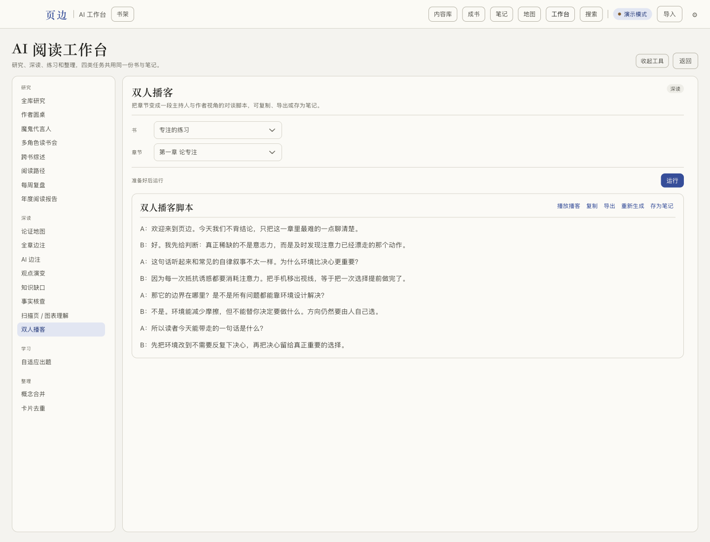
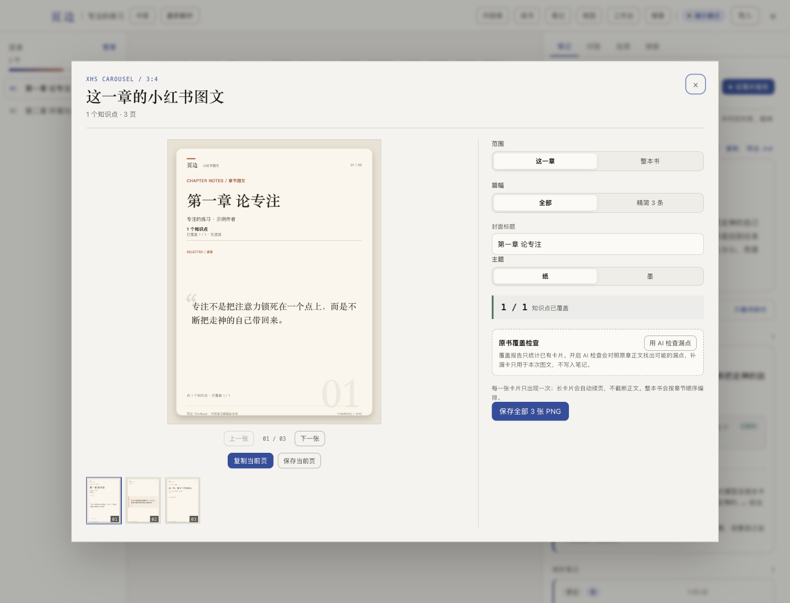

# 页边 · ThinRead

[](LICENSE)
[](#安装与构建)
[](https://github.com/qweijiaq/ThinRead/releases)
[](https://github.com/qweijiaq/ThinRead/actions/workflows/ci.yml)

**中文** · [English](README.en.md) · [官网](website/) · [用户手册](docs/user-manual.md) · [PDF](docs/user-manual.pdf) · [HTML](docs/user-manual.html) · [Releases](https://github.com/qweijiaq/ThinRead/releases)

> 大多数读书工具优化的是「收集」：划更多线、存更多摘录、建更大的库。
> 页边优化的是「产出」：读完这一章，你手里应该有一篇能直接发出去的稿子。

页边（ThinRead）是一个本地优先的 AI 阅读工作台。它把一本书的每一章改写成保留全部论点的可发布草稿，从草稿里提炼 5–25 张真正影响理解的核心卡片，再用本地语义索引把卡片、笔记和其他书连成一张可检索的网。导入 EPUB / PDF / MOBI / 网页 / 微信读书 / Readwise / Kindle 划线，导出 Markdown、自包含 HTML、排版 PDF 或完整发布包。

Electron + React + TypeScript，数据留在本机，MIT 开源。


---

## 为什么是「读薄」

一本书读完，真正留下来的通常不是划线数量，而是三件事：**作者到底主张了什么**、**哪几个概念支撑了这个主张**、**它和我读过的别的书有什么关系**。

主流工具在这三件事上都只做了一半。划线工具把输入做得很好，输出仍然是一堆需要二次整理的碎片；笔记工具把存储做得很好，跨书关联仍然靠手动双链；问答工具把检索做得很好，答案看完就散了。

页边把顺序倒过来：**先定义产出，再倒推阅读流程。**

- 产出是「一篇能发的稿子」，所以读薄不是摘要，而是按断言重写整章；
- 产出要能被复用，所以卡片只从读薄稿里提炼，而不是从原文发散；
- 产出要能被连接，所以跨书关联走本地向量，而不是把笔记上传到云端。

这条路径是强制的：**读薄 → 卡片 → 有限延伸**，三个阶段不跳步。跳步就会退化成「摘要 + 一堆摘录」，也就是这个应用想避免的东西。

---

## 三个核心能力

**读薄成稿**
不按页摘要，而是识别每一处「作者在主张什么」，区分断言、论证材料和铺垫，再按断言结构重写整章。压缩幅度由模型根据内容密度决定，目标是不超过原文一半。生成的稿子可以直接编辑、继续润色、导出 Markdown/HTML/PDF。

**核心卡片**
从读薄稿按压缩后字数提炼 5–25 张卡片。每张卡必须写清知识点、它在全文中的作用、以及能在本章逐字找到的原文依据——找不到依据就留空，不把模型改写过的句子伪装成原文。

**跨书知识网**
笔记标题、标签和正文在本机用 BGE-small-zh 计算向量并缓存，找出其他书里语义相近的笔记。配合知识地图、人物关系图和章节问答，把「这本书说了什么」变成「它和我读过的书有什么关系」。

---

## 产品一览

| 书架 | 阅读与笔记 | AI 工作台 |
| --- | --- | --- |
|  |  |  |

| 整本成书 | 分享卡 | 小红书图文 |
| --- | --- | --- |
|  |  |  |

更多界面与阅读统计见 [功能一览](docs/features/README.md)。

---

## 工程

产品定位决定工程约束。既然承诺「本地优先」和「引用可核对」，这两件事就不能只是文案。

### 数据边界是架构约束，不是隐私声明

解析、存储、检索、渲染全部在本机完成。外部请求只有两类：显式发起的模型调用，以及首次建立语义索引时下载约 23MB 的量化模型。

- 书、章节、笔记、生成记录在本地 SQLite
- API Key 用系统钥匙串加密，无钥匙串时回退为 0600 权限文件
- 语义向量在本机计算，笔记内容不出网
- AI trace 只记录步骤、模型、耗时、token 和错误，不记录正文或 prompt

### AI 结果有一层可靠性工程

模型输出不可信，所以每条生成结果都要过一遍可验证的关卡。

- **引用校验**：AI 给出的原文必须能在本章做规范化匹配，对不上就标记「未核对」
- **内容完整性校验**：排版结果会和「原文 − 已移除片段」比对，改写或漏掉太多就整次拒绝
- **结构化输出归一化**：先试流式宽松解析，字段名或类型不一致时归一化，再回退纯文本 JSON
- **失败不落半成品**：zod 在写入前校验，非法数据被拒绝，不会先删旧笔记再写坏数据
- **可回退**：排版结果单独存 `formatted_html`，原始 HTML 永远保留，随时「还原原文」

### 数据完整性

- SQLite 用 `PRAGMA user_version` 做有序迁移，旧库在事务里补齐列，失败回滚
- 读取时也校验笔记，旧库里的非法枚举或损坏 JSON 降级修复，不让单条坏数据锁死整章
- 书、章节、笔记、生成内容各有 30 天回收站
- 合并、拆分、重新解析、删除前自动备份；书文件按内容哈希去重，多份备份共享同一份 blob

### 性能与成本

- 读薄按小节并发（默认 4 路），断言回查与卡片提炼并行
- 同一章 + 同一模型 + 同一档位的结果按内容哈希缓存 14 天，命中时 0 token
- 精读档复用 24k 原文前缀（Anthropic 显式 `cache_control`，OpenAI 兼容端点走自动前缀缓存）
- 短章、低压缩率、小卡片集自动跳过收益不高的阶段
- 全文索引缓存到 `search-index.json.gz`，签名不变时启动直接加载
- 生成快照按「工具 + 范围」只保留最近 30 份，收藏和当前版本不参与清理
- 模型请求失败按指数退避重试，只对 429 / 5xx / 超时等可恢复错误生效

### 验证

- 266 个回归测试，覆盖划线解析、OCR 切章、发布包、分类、关系图、全文索引、备份恢复、schema 校验、迁移升级
- 无头 Electron 跑书架、搜索、阅读器划词、听读、笔记编辑、地图、导入和分页
- Storybook 像素基线 + CI 逐像素比对，布局漂移会失败
- axe-core 注入 UI 冒烟，扫描 WCAG 2A/2AA 的 critical/serious 问题
- 没有 API Key 也能跑 CI：真实模型录制一次，之后回放
- `check:boundaries` 阻止渲染层引用 Electron 或 Node 内置模块，架构边界在 CI 里强制

---

## 和同类工具的区别

| | 页边 ThinRead | Readwise Reader | Obsidian | NotebookLM |
|---|---|---|---|---|
| 核心定位 | 把书读成可发布稿、卡片和跨书关联 | 收集、阅读和回顾划线 | 通用双向链接知识库 | 基于资料集的问答、摘要和音频概览 |
| 一本书的产出 | 读薄稿、核心卡片、问答、分享卡/PDF | 高亮、笔记和回顾 | 笔记、链接和插件扩展 | 回答、摘要、音频 |
| 跨书能力 | 本地语义回声 + 知识地图 + 关系图 | 以标签和回顾为主 | 手动双链或插件 | 主要围绕当前资料集 |
| 数据位置 | 本地 SQLite + 文件 | 云端服务 | 本地文件 | 云端服务 |
| 适合的读法 | 深度读非虚构并继续写作 | 高频收集和回顾 | 自己维护知识体系 | 快速理解一组资料 |

这不是功能穷举，而是定位差异：页边不替代阅读器，也不试图做完整知识库；它专注于「读完这一章之后，能留下什么可复用的东西」。

---

## 面向平台与开发者计划

页边是一个已经发布、有完整功能面和真实工程约束的独立产品，不是演示原型。如果贵方在运营开发者计划、模型平台或应用分发平台，下面是可核对的对接面。

**已经具备的**

- 完整产品闭环：导入 → 阅读 → 读薄 → 卡片 → 成书 → 分享/导出
- 清晰的本地/云端边界：哪些能力必须在本机，哪些可以托管，架构上是分开的
- 可替换的模型层：OpenAI 兼容端点 + 原生 Anthropic / 百炼 TTS，内置 10 家服务商预设
- 工程基线：类型检查、266 个回归测试、渲染层与 PDF 冒烟、像素基线、无障碍扫描、无 Key 的 AI 录制回放
- 真实的长尾场景：392 页 PDF、扫描版 OCR、代码块重建、多语言排版——不是玩具数据集

**迁移到托管运行时的成本（诚实评估）**

- 可复用：React 渲染层、提示词与三段式生成流水线、卡片与引用校验逻辑、分享与导出渲染
- 需要重写：Electron 主进程、SQLite 存储、文件系统与 OCR、`printToPDF`
- 结论：这不是「接一个 SDK」就能完成的事，而是一次平台移植。任何合作都应以此为前提讨论，而不是按「上架一个应用」估算。

**合作可以长什么样**

- 平台侧：提供运行时、托管存储、持久记忆与分发入口
- 项目侧：把一个有真实深度使用场景的 AI 应用带到平台上，并作为案例验证「本地优先 + 云端能力」的混合架构
- 双方都能验证的指标：真实使用量、留存、单章生成成本、引用核对通过率

**技术交流**：GitHub Issues，或通过 [官网](website/) 上的联系方式。

---

## 快速开始

要求 Node >= 22、pnpm 10+：

```bash
pnpm install
pnpm dev
```

首次启动是空书架。点「导入」选一本 EPUB/PDF，保持右上角的「演示模式」，打开书后点「✦ 读薄并提炼」即可看到完整流程，不需要 API Key。

没有书？导入 [samples/sample.epub](samples/sample.epub)（两章示例书）。要接真实模型，见下面的「接模型」。

> macOS 安装包已发布在 [Releases](https://github.com/qweijiaq/ThinRead/releases)；只构建 macOS 未签名版本，不签名、不公证。

**第一次使用，先走这一条路径**：导入一本书 → 打开一章 → 点「✦ 读薄并提炼」→ 看核心卡片 → 点「成书」。

**几个词**：**读薄** = 把一章改写成可发布文章；**卡片** = 影响理解的核心知识点；**成书** = 把整本读薄稿合成一篇长文；**回声** = 其他书里与你当前内容相近的笔记。

**适合谁**：读非虚构、历史、研究资料，想把一本书变成文章、卡片或分享内容的人；已经有一批书和笔记，想找回跨书关联的人；愿意把数据放在本机、自己管理模型 Key 的人。

**不适合谁**：只想要一个纯阅读器、不需要 AI 的人；依赖手机端或多人实时协作的人；完全不希望配置 API Key、也不接受本地模型配置的人。当前只验证 macOS，Windows/Linux 暂不发布安装包。

---

## 安装与构建

如果 Electron 二进制下载很慢，先设置镜像再安装：

```bash
ELECTRON_MIRROR=https://npmmirror.com/mirrors/electron/ pnpm install
```

pnpm 10+ 默认拦截依赖的构建脚本；项目里的 `pnpm-workspace.yaml` 已经放行 `electron` 和 `esbuild`。

生产构建：

```bash
pnpm build
pnpm start
```

打包：

```bash
pnpm run pack      # 只生成当前平台的未签名应用目录
pnpm dist:mac      # macOS dmg + zip（不签名、不公证）
pnpm dist:win      # Windows nsis 安装包
pnpm dist:linux    # Linux AppImage
pnpm dist:all      # 三个平台一起构建（需要在对应系统或 CI 矩阵里跑）
```

产物在 `release/`。推送 `v*` tag 会触发 `.github/workflows/release.yml` 只构建 macOS 产物。

---

## 接模型

右上角设置 → 选服务商 → 填 Base URL、模型、API Key → 「测试连接」。模型输入框会按服务商给出推荐候选；配置 Key 后可以「从服务刷新模型列表」，在可搜索的列表里选择全部可用模型，也可以直接粘贴任意模型 ID。

预置了 DeepSeek、智谱 GLM、Anthropic、OpenAI、Moonshot、阿里云百炼、OpenRouter、OpenCode Zen / Console、OpenCode Go 和本地 Ollama，也可以填入任意 OpenAI 兼容端点。API Key 用系统钥匙串加密保存在本机；没有钥匙串时回退为 0600 权限的本地文件。

设置里可以为读薄、成稿和工作台分别指定模型，留空使用全局模型；也可以选快速 / 标准 / 精读三档生成质量。还可以设置月度 AI 预算：按模型价格估算，到上限后新的生成会被拒绝，已经生成的内容和本地功能不受影响。

---

## 功能

> 下面是主线能力。逐项的行为细节、边界条件和失败处理见 [用户手册](docs/user-manual.md)。

### 导入与解析

- **电子书**：EPUB / PDF / MOBI / AZW3。EPUB 保留章节结构、排版和图片；MOBI 读取目录和章节；DRM 加密文件会明确报错。
- **PDF**：优先按书签/大纲切章，没有书签时识别页首 Chapter / Part / 第 N 章，最后才按页分组；含图表的页面生成版式预览图。
- **深度解析**：复杂 PDF 可选 Docling，保留版面、表格和图表，并按坐标重建代码块的换行与缩进。
- **扫描版 PDF**：macOS PDFKit 渲染 + Vision 逐页 OCR，可指定起止页，单次最多 300 页，走后台任务中心。
- **文档与网页**：DOCX / HTML / Markdown / TXT 保留标题层级并自动切章；网页去掉导航和广告后抽取正文，图片内联到本地；整书打印页递归按标题切章。
- **划线**：Readwise CSV、Kindle `My Clippings.txt`、微信读书导出的 TXT/Markdown/HTML；每条划线保存为高亮笔记，标签和备注一起保留。
- **自动清理**：本地规则识别封面、版权页、目录、广告、索引、乱码页并隐藏，可随时恢复；导入本身不调用模型。

### 阅读与排版

- **博客级排版**：宋体正文与标题、约 1.86 行高、墨蓝强调色，引用、行内代码、代码块、表格和图片都有完整样式。阅读器有墨蓝 / 纸色 / 纯白 / 暖色四套主题，全局生效。
- **手动编辑正文**：直接改当前章节、删掉无意义内容，保存后写回 `formatted_html`，并自动去掉阅读器临时按钮和代码高亮包装。
- **AI 排版**：一键清理广告、推广、重复标题、页码水印和乱码，整理标题、段落、引用和列表层级。每一处删除都列出原因和原文片段，可逐条保留，也可一键还原。
- **代码块工具**：检查规范与错误符号、一键修复能确定的问题、把混进代码块的正文用该语言注释符注释掉、让模型解释代码并插入正文。
- **图片理解**：视觉模型把 2–6 句说明插入正文；先试当前模型，接口明确不支持图片时，自动从已配置服务商里挑一个可用视觉模型，多个候选中优先便宜的。
- **排版偏好**：字体、字号、行距、段距、首行缩进和版心宽度按书保存，通过 CSS 变量应用，不让模型生成任意 CSS。
- **PDF 原版标注**：原版 PDF 查看器里可以直接框选一块区域做标注，支持黄/绿/蓝三色和备注；标注按书和页码保存，关掉重开仍在。工具栏「标注列表」可以查看全书标注并一键跳到对应页。
- **边读边记**：选中正文浮出操作条——高亮、划线、删除线、清除标记、问 AI、AI 边注、分享、朗读、复制。

### 读薄、卡片与问答

- **三段式生成**：读薄 → 卡片 → 有限延伸，阶段顺序不跳步。面板显示「原文 X 字 → 读薄稿 Y 字（1/N）· 节数 · 卡片数 · 延伸数 · 审计补遗 · 未采纳 · 用时」。
- **断言回查**：提炼卡片时顺带核对遗漏观点，结果进入「补遗」，不写回正文，保持正文可发布。
- **问这一章**：只根据当前章节、读薄稿和卡片回答，引用可点回原文；「考考我」模式先反问，再顺着你的回答追问。
- **页边回声**：阅读时显示其他书里语义相近的笔记，打开是左右对读视图，不离开当前章节。
- **讲给我听**：费曼自测，用自己的话解释这一章，AI 指出讲对、漏掉和理解偏的地方。
- **模型对比**：用另一个模型重跑本章，结果存为独立快照并直接打开行级 diff，不覆盖当前笔记。

### 知识地图与 AI 工作台

- **知识地图**：以书和标签概念为节点，概念按共现连边，跨书概念单独标出；可筛选、搜索、拖动保存位置，导出 Mermaid 或 PNG。
- **人物关系图**：本地全文扫描列人名候选，再分两步抽节点和关系；同名别名自动合并，标注出现章节，按方向显示「杀害 / 被杀害」这类互逆标签。
- **AI 工作台**：按研究、深读、学习、整理四组组织 19 个工具，覆盖全库研究、作者圆桌、跨书综述、论证地图、自适应出题、概念合并和卡片去重。
- **后台任务**：整本生成和整本排版有任务中心，写入本地数据库，重启后变「已暂停」，可跳过已完成章节继续。

### 成书、分享与导出

- **整本成书**：一次给未完成章节生成读薄稿，再合并、去重、补导语和过渡，做最后一轮去 AI 味润色。可选精炼版 / 完整版，以及克制准确 / 读者视角 / 有判断。
- **按段重写**：选中一段只让模型重写这一段，应用前先看行级 diff。
- **成稿版本**：每次合并保存为一个版本，可回看、另存、恢复为当前。
- **导出**：复制全文、`.md`、不依赖外部资源的 `.html` 分享页、A4 排版 PDF。
- **发布包**：`index.html`、`cover.png`（同时是 1200×630 OG 图）、`metadata.json`、BibTeX/RIS/APA 引用文件、可选 `notes.md`，打成 zip 丢到任意静态托管即可发布。
- **分享卡**：金句卡 / 知识卡 / 读薄卡 / 整本书 / 长图 / 里程碑六种版式，纸、墨、苔绿三套主题，本地 Canvas 渲染。
- **小红书图文**：一组 3:4 帖子图，自动加封面和结尾，把核心知识点分页排完；可切换「精简 3 条」。

### 笔记库、搜索与数据

- **全局搜索**：`⌘K` / `Ctrl+K` 跨书名、章节正文和笔记搜索；关键词倒排索引先返回，本地语义检索随后补充，两路结果用 RRF 融合排序。
- **笔记库**：按书、类型和标签筛选；「笔记审计」显示 AI/人工修改、引用核对状态和章节覆盖度；可导出带 YAML frontmatter 的 Markdown 文件夹，直接放进 Obsidian 或导入 Notion。
- **笔记互链**：`[[笔记标题]]` 互相引用，自动显示反向链接、同书和跨书相关笔记。
- **书架状态**：每本书的书卡上有「状态」下拉，可以选待读 / 在读 / 读完 / 已归档；新导入的书默认是待读，打开一章后自动变成在读。书架顶部按状态筛选并显示数量。
- **零配置听读**：没配千问 TTS Key 时自动使用 macOS 内置语音，完全在本机合成、不产生费用；配了 Key 仍然走千问，音色和费用估算不变。
- **阅读数据**：阅读时长、每日目标、连续天数、7/30/100 天里程碑徽章、月度/年度统计、周复盘、CSV 导出；统计页同时显示笔记质量和引用核对通过率。
- **备份与恢复**：手动/自动备份、整库导出导入、应用锁、诊断包；合并、拆分、重新解析或删除书籍前自动备份。
- **文件夹同步**：设置里选一个 iCloud Drive / Dropbox / NAS 文件夹，推送整库快照，其他设备拉取恢复；快照会自带书文件，换设备恢复不会缺书，所以体积会比本地备份大。可选填口令，用 AES-256-GCM 加密成 `.thinsync`，口令不落盘。除了整库恢复，还可以只把快照里较新的笔记、PDF 标注、书签、阅读位置、阅读统计、阅读计划和周复盘合并进当前库，不覆盖本地内容；本地没有的书会连同章节和书文件一起导入。不依赖自建服务端，恢复前会自动备份当前状态。

---

## 数据在哪

macOS：`~/Library/Application Support/reading-notes/`

| 路径 | 内容 |
| --- | --- |
| `reading-notes.db` | SQLite：书、章节、笔记、语义向量、生成内容快照 |
| `books/<id>/source.epub\|pdf` | 导入的原始文件 |
| `settings.json` | 模型配置和加密后的 Key |
| `backups/` | 手动/自动备份 zip，书文件按内容哈希去重 |
| `ai-traces/` | 按天写入的 AI 步骤 JSONL，只记元数据，不记正文 |
| `notes-cache/`、`tts-cache/` | 内容缓存和 TTS 音频缓存，可随时删除 |
| `search-index.json.gz` | 全文倒排索引缓存 |
| `models/` | BGE-small-zh 量化模型缓存（约 23MB） |

---

## 项目结构

```text
electron/
  main.ts             主进程入口、窗口、开发验证模式
  ipc.ts              渲染层与主进程的 IPC 契约实现
  ipc/extras.ts       书架状态、统计、同步和 PDF 标注的 IPC
  ipc/parse.ts        IPC 参数的 zod 边界校验
  db.ts               SQLite 存储、版本化迁移、书 / 章节 / 笔记 / 标记 / 排版结果
  pdf.ts              Electron printToPDF：分享页 HTML → A4 PDF
  import.ts           解析、自动清理并写入一本书
  settings.ts         模型配置与 Key 的本地存储
  html.ts             HTML 清洗、文本提取、图片占位与还原
  ai/provider.ts      AI SDK provider 构造
  ai/notes.ts         读薄、断言回查、核心卡片、有限延伸
  ai/format.ts        AI 排版：结构化输出、移除核对、内容完整性校验
  ai/tutor.ts         章节问答、苏格拉底追问、费曼自测评估
  ai/lab.ts           AI 工作台：研究、圆桌、综述、论证、出题、合并与关系图
  ai/book-compose.ts  整本成稿：分组改写、统一润色、去 AI 味与长文组装
  ai/code-assist.ts   代码检查 / 修复 / 理解
  ai/trace.ts         AI 步骤 JSONL trace：耗时、token、模型与错误
  semantic.ts         本地语义索引：BGE-small-zh 嵌入、增量索引、跨书相关笔记
  knowledge-map.ts    知识地图：书/概念节点、共现与归属连边
  backup.ts           数据库快照、书籍/设置打包、自动备份与恢复
  parsers/            EPUB / MOBI / PDF / Docling / OCR / 划线 / 网页
shared/
  types.ts            主进程与渲染层共享的类型和 provider 预置
  schemas.ts          zod 运行时 schema：AI 笔记、笔记、关系图、题目
src/
  App.tsx             应用状态与流程编排
  components/         书架、阅读器、笔记、成书、分享、内容库、回声、听读、地图、工作台
  lib/                分享卡、小红书图文、Mermaid、博客导出、搜索与链接
  stories/            Storybook 隔离预览与主题装饰器
```

---

## 设计取舍

1. **笔记是 block 级的，不是一篇可覆盖的 Markdown。** 每条笔记记录来源、作者（AI/我）、是否被人工编辑、引用的原文。这是「AI 自动生成」和「用户边读边改」能共存的前提。
2. **章节也带来源标记和篇归属。** 每一章记录分类、是否隐藏、由规则还是 AI 判断，以及属于上篇/下篇。
3. **目录页整页保留，不逐条拆开。** 只有真正的章级标题才切分，避免把目录条目混进章节列表。
4. **先读薄，再提炼卡片，最后才延伸。** 卡片只从读薄稿里按压缩后字数提炼，不在原文上发散，避免制造卡片墙。
5. **引用必须可校验。** 读书笔记最怕的不是总结得平庸，而是编造原文。
6. **笔记链接分三层。** 显式 `[[标题]]`、自动反向链接、本地语义向量带来的同书/跨书相关笔记。
7. **AI 排版只动显示层。** 清理结果单独存 `formatted_html`，原文永远保留；样式偏好是结构化配置。
8. **本地优先。** 解析、存储、检索都在本机；笔记内容不会离开设备。
9. **读薄稿和生成说明分开。** 未采纳内容、审计补遗属于生成报告，不进入导出的正文。
10. **跨书关联用本地向量，不把笔记发出去。** 模型缺失时自动回退到标签匹配，界面不会因此空白。
11. **阅读现场的 AI 有边界。** 问答和自测只使用当前章节、读薄稿和卡片，对不上就标记「待核对」。
12. **知识地图是导航，不是本体论。** 连线表示共现或同属一本书，不代表严格的定义关系。
13. **AI 工作台是编排层，不是新的事实来源。** 每个结果都标为草稿，引用仍应回到原文核对。
14. **整本成稿不是把章节拼起来。** 小书单次终审；大书先按约 1.2 万字分组改写，再做全书终审。
15. **生成内容是一等资产。** 每次生成都有来源、状态和版本；内容库负责找回、应用和清理。

---

## 开发验证

```bash
pnpm typecheck                 # 渲染层 + 主进程类型检查
pnpm build                     # esbuild 主进程 + vite 渲染层
pnpm test                      # 固定回归测试
pnpm test:ui                   # 构建后启动无头 Electron 回归主要界面
pnpm test:ui:pdf               # 一页 PDF 回归原版版式查看、翻页和缩放
pnpm test:packaged             # 对 release/mac-*/*.app 跑打包产物冒烟
pnpm test:e2e                  # 可选：用真实模型跑读薄 + 成稿 + 双人播客（消耗 token）
pnpm eval:real                 # 可选：3 个固定章节的真实模型质量评测
node_modules/.bin/electron . --smoke-test
```

AI 录制 / 回放（用于没有 API Key 的 CI）：

```bash
THINREAD_AI_RECORD_DIR=/tmp/ai-fixtures pnpm eval:real   # 录制
THINREAD_AI_REPLAY_DIR=/tmp/ai-fixtures pnpm test        # 回放
```

界面验证可以用开发模式参数：

```bash
node_modules/.bin/electron . --data-dir=/tmp/rn-demo --seed-demo --open-first \
  --screenshot=/tmp/reading-notes.png
```

Storybook 隔离预览与像素基线：

```bash
pnpm storybook
pnpm capture:storybook
pnpm capture:storybook -- --check
```

---

## 已知限制

- macOS 是主要验证平台；Windows / Linux 提供构建脚本，但 OCR 和 PDF 图表预览仍依赖 macOS Vision，其他平台会明确提示不支持。
- 安装包未签名、未公证，首次打开需要在系统设置里手动允许。
- PDF 默认是文字层重排阅读；扫描版需要走「扫描版 PDF（OCR）」入口。
- 合并只读取已有读薄稿，不会回头逐字核对原文；润色后的稿子仍需人工过一遍。
- 读薄的断言回查只检查章节前 24k 字，超长章节的尾部可能不在回查范围内。
- AI 排版超过约 6 万字符的章节会提示不支持；长章节按约 14k 字分段，个别分段失败时保留原文。
- 跨书语义关联首次使用会下载约 23MB 的 BGE-small-zh 量化模型，默认走 `hf-mirror.com`，可用 `HF_ENDPOINT` 换镜像。
- 界面以中文为主，设置里可切到 English（Beta）；导出文案跟随界面语言，书籍正文和笔记保持原文。
- HTML 分享页是纯文字排版，不包含书里的插图。
- 保真审计是 AI 对照原文做的，不是形式化证明；它用来发现明显遗漏，不保证每个隐含意思都被显式写出。

更完整的边界条件见 [用户手册](docs/user-manual.md)。

---

## 安装包与 Release

最新 macOS 未签名安装包见 [Releases](https://github.com/qweijiaq/ThinRead/releases)。当前 v0.2.0 是内测预发布，提供 arm64 DMG / zip 和完整内测 bundle；不做签名和公证，首次打开需要在系统设置里手动允许。v0.1.0 是第一个公开安装包。

推送 `v*` tag 的发布流程有一道硬门禁：先跑 `pnpm typecheck`、`pnpm test`、渲染层与 PDF 冒烟，并校验 tag 与 `package.json` 的版本号一致，通过后才复用同一份构建产物打包。发布 job 会上传 dmg、zip 和 blockmap（增量更新需要）。

签名是可选的：仓库里配好 `MAC_CERT_P12`、`MAC_CERT_PASSWORD`、`APPLE_ID`、`APPLE_APP_SPECIFIC_PASSWORD`、`APPLE_TEAM_ID` 后，会自动签名并公证；没有密钥时保持 ad-hoc 签名的未签名产物，流程不中断。未签名构建的自动更新默认关闭（`THINREAD_UPDATER=1` 可临时开启验证）。

---

## Roadmap

- [x] 本地优先的 EPUB/PDF/MOBI/网页导入、读薄、卡片、跨书回声和知识地图
- [x] 章节问答、费曼自测、AI 工作台、分享卡、小红书图文、Markdown/HTML/PDF 导出
- [x] zod 边界校验、版本化 SQLite 迁移、AI trace、固定样例评测和 Storybook 视觉基线
- [x] macOS 未签名安装包（v0.1.0）
- [x] Docling 深度 PDF 解析、正文编辑、图片理解、代码检查/修复（v0.2.0）
- [ ] 30–60 秒演示 GIF
- [ ] Windows/Linux 实机验证
- [ ] 数据库加密与端到端同步

---

## 更新记录

- **2026-11-11**：发布 v0.2.0。接入 Docling 深度解析，优先按书签/标题切章并恢复代码块换行与缩进；新增手动编辑正文、图片理解、代码检查/修复/理解；自动从已配置服务商中选择可用的视觉模型；清理 PDF 导入中的小图、项目符号和表格噪声。
- **2026-11-08**：重新打包 v0.1.5 macOS arm64 内测包；应用功能与 v0.1.4 一致，官网同步白底/深色模式和留言服务。
- **2026-11-06**：发布 v0.1.4 macOS arm64 内测包；加入阅读计划、应用锁、笔记审计/导出、版本 diff、按段重写、周复盘独立存储、千问 TTS 音色与 MP3/段落间隔、分享卡和小红书 daily-post 视觉重构；补齐开源协作文档和 CI 可移植性。
- **2026-11-03**：发布 v0.1.3 macOS arm64 内测预发布包，校准 DeepSeek / 智谱 / Kimi / Anthropic / 阿里云百炼的 Base URL 和 Key 入口。
- **2026-11-03**：发布 v0.1.2，为章节、读薄稿、成书、报告、周复盘等文章加入「复制全文」。
- **2026-11-03**：发布 v0.1.1，加入首次引导、成本确认、内嵌手册和圆角图标。
- **2026-11-01**：发布 v0.1.0 macOS arm64 未签名安装包；补充笔记回收站、PDF 页码记忆、AI 流式回答、持久化搜索索引、MIT License 和 macOS-only 发布流程。

---

## 反馈与参与

- 问题、功能建议和评测样例：[GitHub Issues](https://github.com/qweijiaq/ThinRead/issues)
- 开发环境、测试和提交约定：[CONTRIBUTING.md](CONTRIBUTING.md)
- 安全问题请走私密报告：[SECURITY.md](SECURITY.md)
- 社区行为准则：[CODE_OF_CONDUCT.md](CODE_OF_CONDUCT.md)

当前是 `0.2.x` 公开 beta：核心阅读、笔记、成书、分享和本地数据链路可用；同步、数据库加密、跨平台 OCR 和完整英文仍是后续工作。

最近更新：2026-11-11

## License

MIT，见 [LICENSE](LICENSE)。
