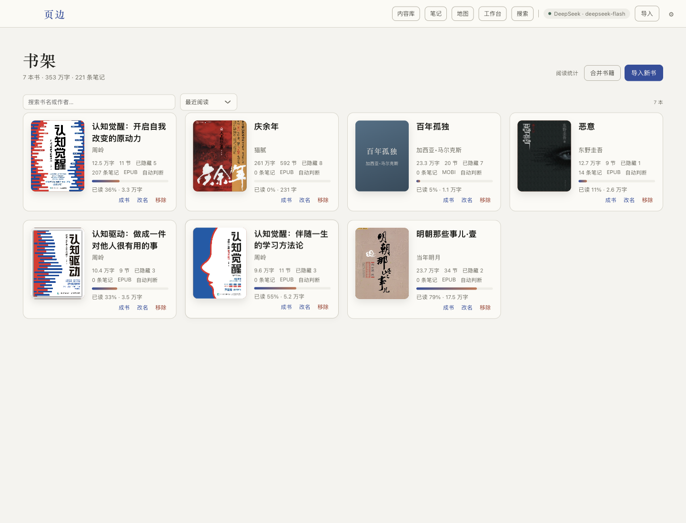
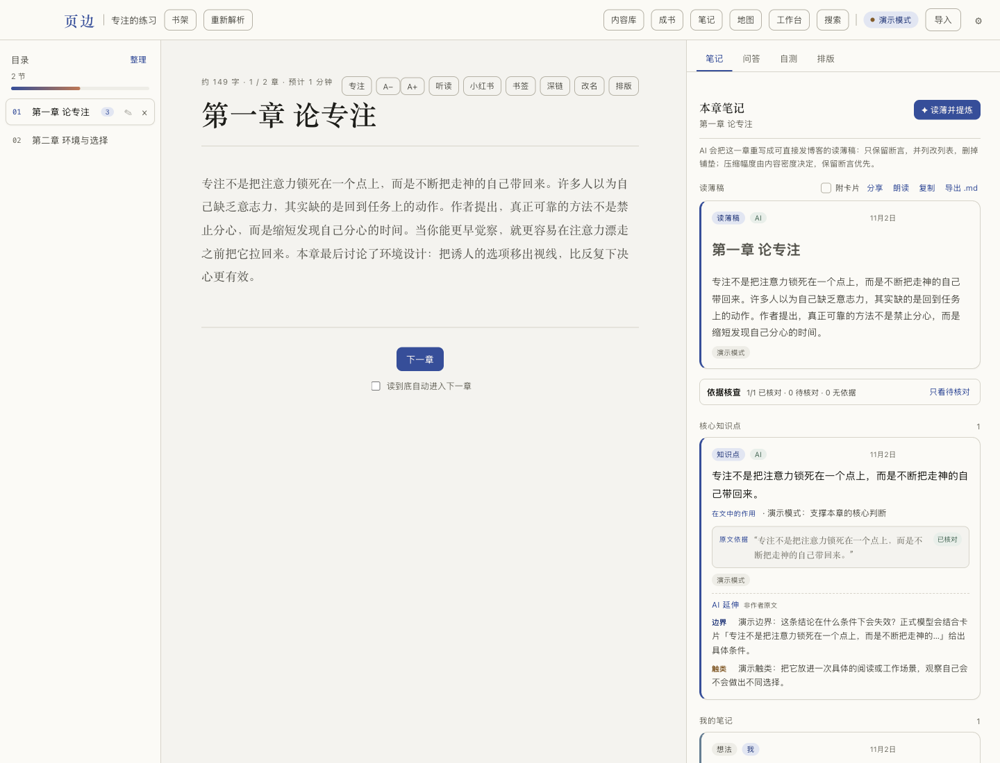
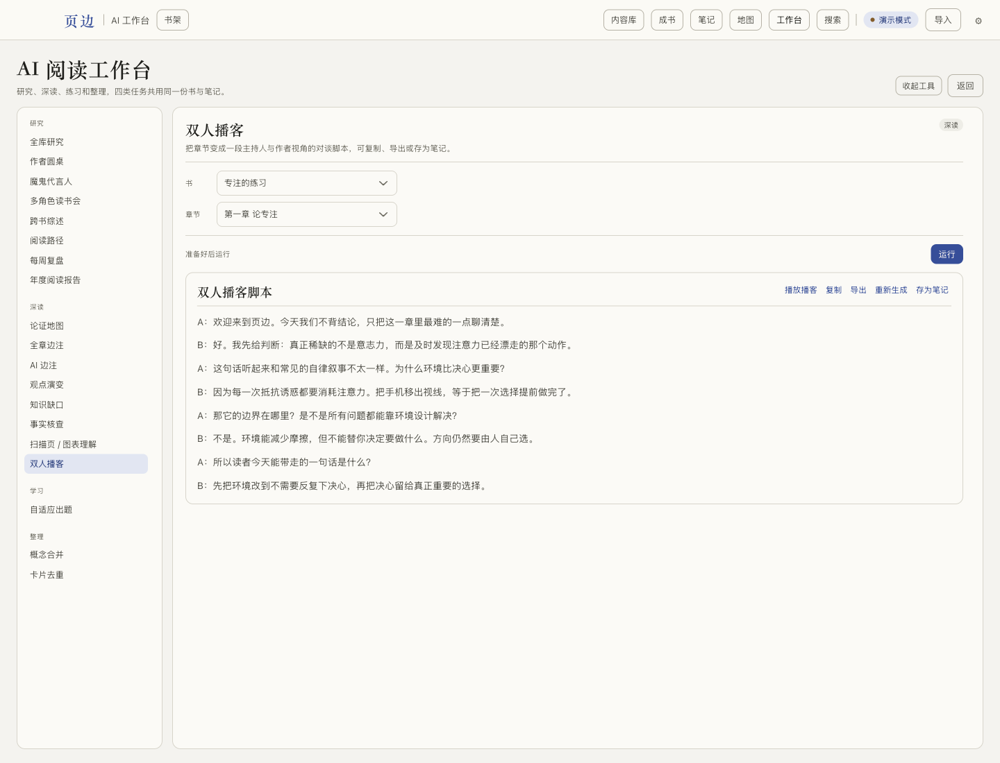
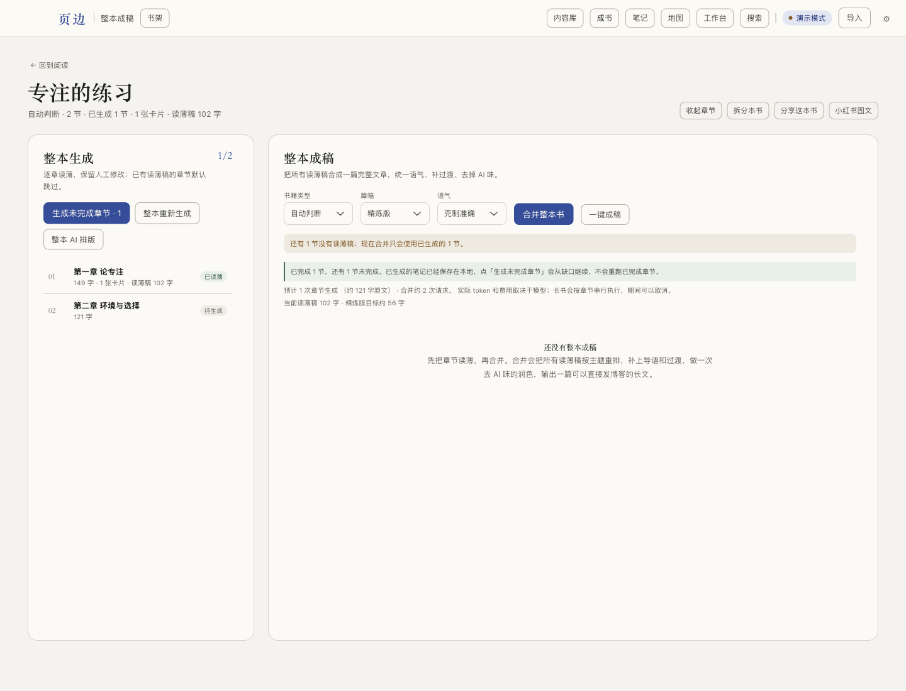
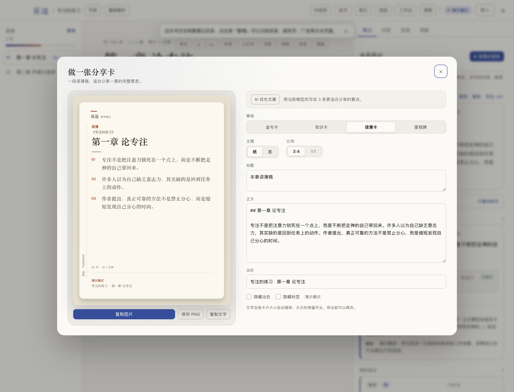
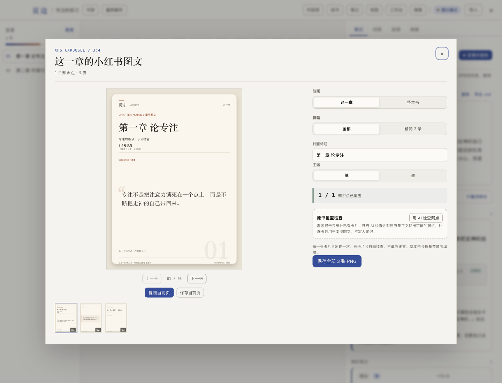
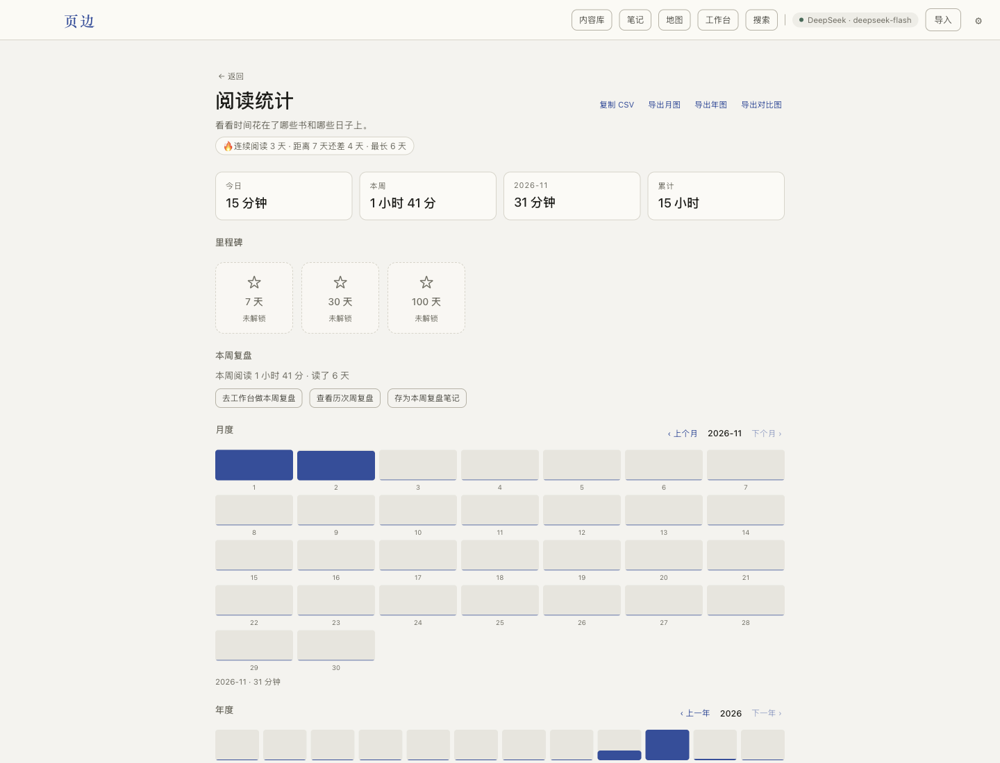

# 功能一览

1440 × 1100 的实际界面截图。书架和阅读统计使用本机书库；阅读器、工作台、成书、分享卡、小红书使用演示书《专注的练习》，不包含个人笔记内容。

| | |
|---|---|
| **书架**<br>导入的书、阅读进度、笔记数与最近阅读 | **阅读与笔记**<br>正文、章节目录、AI 读薄稿与核心卡片同屏 |
|  |  |
| **AI 阅读工作台**<br>研究、深读、练习、整理四组工具；双人播客可直接播放 | **整本成书**<br>逐章读薄后合并成一篇文章，支持多种篇幅和语气 |
|  |  |
| **分享卡**<br>金句、知识点、读薄、整本书、里程碑五种版式 | **小红书图文**<br>封面、内容页、精简 3 条和覆盖检查 |
|  |  |
| **阅读统计**<br>今日/本周/月度/年度、连续天数、里程碑和周复盘 | |
|  | |

## 重新生成

截图由应用自身渲染，使用 CDP 固定 1440 × 1100 逻辑视口：

```bash
pnpm build
env -u ELECTRON_RUN_AS_NODE ELECTRON_DISABLE_SANDBOX=1 ./node_modules/.bin/electron . \
  --data-dir=/tmp/thinread-shots --seed-demo \
  --capture-size=1440x1100 \
  --exec-file=scripts/shots/reader.js \
  --screenshot=docs/features/02-reader.png
```

`--exec-file` 里的脚本负责点击进入对应界面；`--capture-size` 只用于开发和截图，不进入正式功能。
